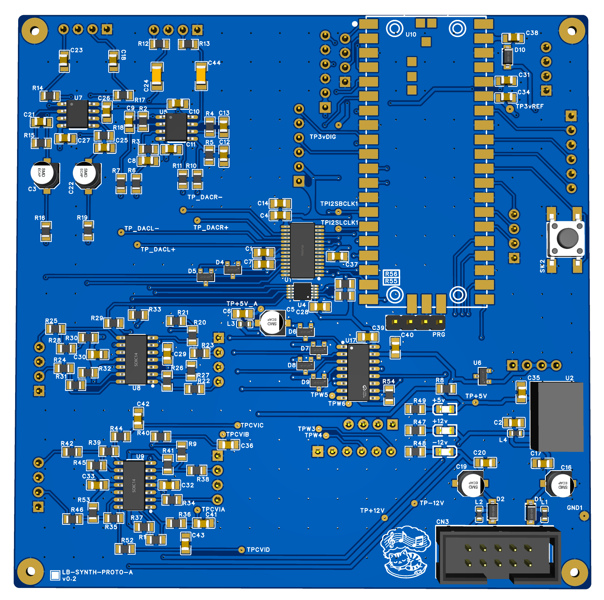

<!-- SPDX-License-Identifier: GPL-3.0-or-later -->
<!-- Copyright (C) 2026 Louis Brooks -->

# pico2-eurorack

This repository provides hardware designs for a Raspberry Pi Pico 2 Eurorack development board.

The idea behind this project was to design a development board for the Pi Pico 2 (or the RP2350) for development of digital Eurorack modules.

Features of this hardware design:

- Support for the Pi Pico 2 microcontroller board - I also considered STM32 microcontrollers for this board, specifically the STM32H743, however for my first mixed signal hardware design I decided to focus on a design that was easier to implement. I also find the development and debugging environment much simpler for the Pico 2.

- PCM3060 audio codec - includes both a stereo ADC and DAC, is stocked everywhere and is a commonly used part in Eurorack designs.

- MCP3208T - one of the downsides of the Pico 2 is the lack of ADCs. This is an 8 channel ADC used for CV inputs and potentiometers. We also use the 3 onboard Pico ADCs along with the MCP3208, which is enough for the 7 potentiometers and 4 CV inputs.

- MCP4728 - 4 channel 12-bit DAC used for CV outputs. Since this is only used for CV we can live with 12-bit. In hindsight a higher resolution DAC would have been good. One of the reasons I chose this DAC in particular is that it can be controlled by I²C and is easy to integrate with the Pico 2.

- 2 gate inputs - read by 2 of the Pico 2 GPIO

- Rotary encoder - read by 3 of the Pico 2 GPIO

- 0.96 in OLED, 128x64 resolution

- The remaining GPIO (GP8, GP9 and GP15) from the Pico 2 have been broken out to the front panel board.

Further hardware information is available in [`hardware/README.md`](hardware/README.md).

## Repository layout

| Folder | Contents | Licence |
|---|---|---|
| [`hardware/`](hardware/) | Schematic, PCB, BOM and assembly files for the DSP board and control board (V0.2), and the hardware documentation | CERN-OHL-S-2.0 |
| [`code/multi-dsp/`](code/multi-dsp/) | MULTI-DSP firmware for the board (C++17, Pico SDK) with host-side tests | GPL-3.0-or-later |

Firmware and documentation were developed with the assistance of Claude (Anthropic). The hardware design is by Louis Brooks.

## Status and to-do
- The hardware has been fully tested using the code in this repository.
- To do: upload a demo video/audio of the board running.
- I ordered the PCBs from JLCPCB for around $20 and the parts from LCSC for around $40. I hand soldered all components, which took several hours. Some components, like the ferrite beads (0603) and small pitch ICs (such as the PCM3060 in TSSOP-28 package and the MCP4728 in MSOP-10 package), may be difficult to hand solder without a hotplate or hot air rework station.
- When designing the PCBs I did not optimise for PCBA. In a future iteration of the design I will optimise for JLCPCB PCBA.

## Licence and credits

Copyright (C) 2026 Louis Brooks.

The software files in this repository (`code/`, and the files in the repository root) are released under the **GNU General Public License, version 3**. The full text is in [`LICENSE`](LICENSE).

The hardware files in this repository (`hardware/`: schematic, PCB, BOM, placement files and the hardware documentation) are released under the **CERN Open Hardware Licence Version 2 - Strongly Reciprocal** (`CERN-OHL-S-2.0`). The standard notice, including the requirement to keep the source location with any product you make from this design, is in [`hardware/README.md`](hardware/README.md#15-licence-and-credits).

Third-party components used when building the firmware (the Raspberry Pi Pico SDK and what it pulls in) keep their own licences; see [`THIRD_PARTY_NOTICES.md`](THIRD_PARTY_NOTICES.md).
