# MULTI-DSP

An 11-module audio-DSP and CV firmware for an **RP2350** (Raspberry Pi Pico 2 class) development board, written in C++17 on the Pico SDK. One firmware image, eleven "modules" selected from a menu: resonator, granular texture, quantizer, utilities, two oscillators, random generator, wave-folding modulator, function generator, a chorus/echo/reverb effect and a CV/LFO generator. Audio runs at 46.875 kHz (the rate the PIO I²S program generates) in 256-sample chunks; a 128×64 OLED shows parameters, a live oscilloscope and a spectrum analyser.

> **Status:** works and is actively iterated on. The DSP and UI are verified by a host-side test suite (`tests/host`). The clocking, pin and codec-register facts in [§3](#3-hardware) were checked against this repository's `i2s.pio` and the TI PCM3060 datasheet.

The module names (Pim's CV, Ringo, Clods, Quirks, Plaids, Brains, Mumbles, Wraps, Tiddly) are tongue-in-cheek riffs on familiar Eurorack module archetypes (resonator, granular processor, rectifier/S&H utility, macro oscillators, random sampler, wavefolder/ring-mod, function generator). The algorithms are independent, simplified implementations written for this project; they make no claim to behave like any commercial or open-source hardware module.

---

## Table of contents

1. [Quick orientation for AI agents](#1-quick-orientation-for-ai-agents)
2. [Screenshots](#2-screenshots)
3. [Hardware](#3-hardware)
4. [Software architecture](#4-software-architecture)
5. [Code map](#5-code-map)
6. [DSP conventions and the engine contract](#6-dsp-conventions-and-the-engine-contract)
7. [Modules](#7-modules)
8. [User interface](#8-user-interface)
9. [Audio-quality design decisions](#9-audio-quality-design-decisions)
10. [Testing](#10-testing)
11. [Building, and extending the code](#11-building-and-extending-the-code)
12. [Known issues, unverified assumptions and ideas](#12-known-issues-unverified-assumptions-and-ideas)
13. [Change history](#13-change-history)

---

## 1. Quick orientation for AI agents

Read this section first; it is the minimum you need to work safely in this code base.

| Fact | Value |
|---|---|
| Language / SDK | C++17, Pico SDK (RP2350, Cortex-M33 with single-precision FPU) |
| Source layout | **One firmware source file**: `main.cpp` (~2,900 lines), six numbered sections (see [§5](#5-code-map)). Build files in this repo: `CMakeLists.txt` (target `dev_dsp`) and `i2s.pio` (I²S master TX + RX PIO programs). Not in this repo: `pico_sdk_import.cmake` (copy it from the Pico SDK's `external/` folder) |
| Audio | **46,875 Hz** (`SAMPLE_RATE`; set by `i2s.pio`, *not* 48 kHz — see [§3.1](#31-clocking-why-the-rate-is-46875-hz)), stereo 32-bit I²S words, **256 frames per chunk** (5.46 ms), double-buffered DMA, processed inside a DMA interrupt on **core 0** |
| UI / control | **Core 1**: ADC/SPI scanning of pots and CV, buttons, encoder, OLED rendering |
| Inter-core communication | `std::atomic` globals only (listed in [§4.4](#44-shared-state-between-the-cores)) |
| Host tests | `cd tests/host && ./run_tests.sh` (needs only `g++`). **Run them after every change to DSP or UI code.** All must print `RESULT: PASS` |
| Screenshots | `./run_tests.sh screens` regenerates `docs/img/*.png` from the real UI code |
| Time budget | Every engine must finish a chunk in < 5.46 ms. The firmware counts a chunk above 97 % of the budget as an *xrun* |
| Memory | ≈ 466 KB of 520 KB SRAM used by statics. **There is little headroom** (see [§4.6](#46-memory-budget)) |

### Hard rules (violating these causes audible faults or crashes)

1. **The audio path runs in an interrupt.** In `process_audio_chunk` and everything it calls: no blocking, no `printf`, no I²C/SPI, no heap allocation, no `rand()` (use `xrand()/rnd01()/rnd_bi()`), no waiting on the other core.
2. **Core 1 must never write engine-private state** (the `static` variables inside the `process_*_chunk` sections). Communicate through the atomics. (Existing exceptions are listed in [§12](#12-known-issues-unverified-assumptions-and-ideas).)
3. **Every engine output must be bounded.** Always emit audio with `write_stereo()`; it NaN-guards, counts overs, soft-limits and converts. Design gain structure so that signals stay within ±1 *before* it (see [§9](#9-audio-quality-design-decisions)).
4. **Use `sp[i]` (per-sample ramped) for continuous parameters and `sp_tgt[i]` for per-chunk decisions.** Call `params_tick()` exactly once per sample.
5. **The OLED font only has ASCII 32–90** (upper case; lower case is auto-upper-cased). `[ ] _ | { } ~ ^ \` and accented characters are **not drawn**. Use `<` `>` `*` `/` `:` `-` `.` `%` `&` `+` `=` `'` `!` instead.
6. **Keep UI strings short.** Screen width is 21 characters at 6 px per glyph.
7. When adding a module/setting/view follow the checklists in [§11.3](#113-checklist-adding-a-module) and [§11.4](#114-checklist-adding-a-setting-or-a-view).

---

## 2. Screenshots

All images are generated by the real drawing code running on a PC (`tests/host/render_screens.cpp`), at 5× magnification. They show a Plaids test tone as the signal.

### Boot and main screens

| | |
|---|---|
| 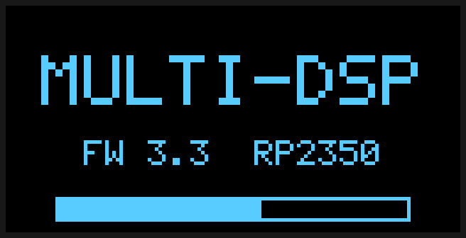 | 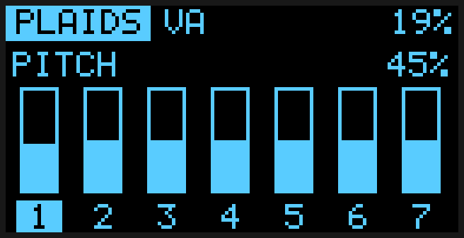 |
| **Boot splash** with progress bar | **PARAMETERS view**: seven bars (the post-CV value of each pot), the highlighted number is the last pot touched |
| 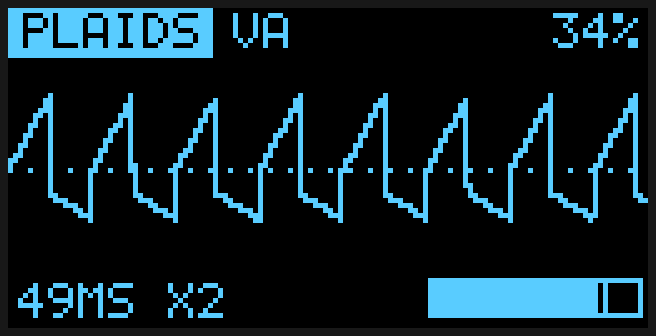 | 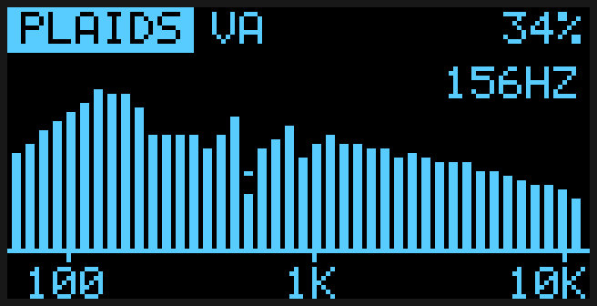 |
| **SCOPE view** (default 49 ms across the screen, `X2` = auto-gain, bar = output level) | **SPECTRUM view**: 42 log-spaced bars 60 Hz–11.7 kHz (Nyquist of the decimated scope ring), peak caps, peak-frequency read-out |
| 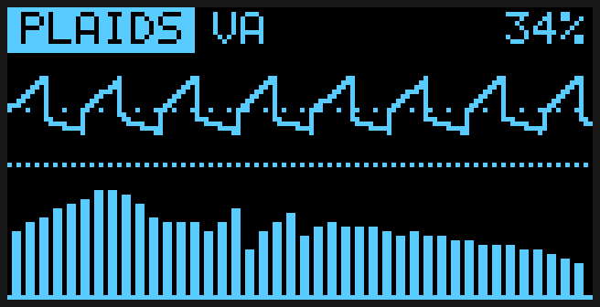 | 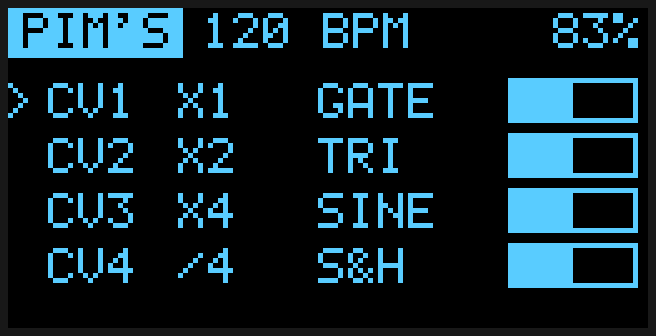 |
| **SCOPE + SPECTRUM** combined view | **Pim's CV view** (replaces the parameter view in that module): ratio, shape and live level of the four CV outputs |

### Overlays and header states

| | |
|---|---|
| 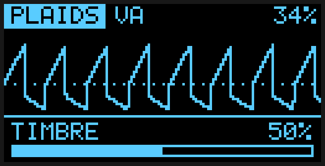 | 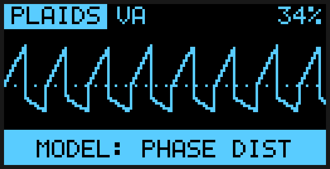 |
| **Parameter overlay**: moving a pot shows its name, value and a bar for 1.6 s over any view | **Toast**: short status message (here after changing the model) |
| 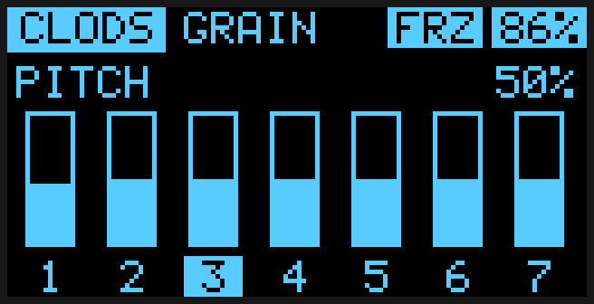 | |
| **Header tags**: `FRZ` = frozen, inverted CPU tag = load above 85 % or a recent xrun | |

### Menus

| | |
|---|---|
| 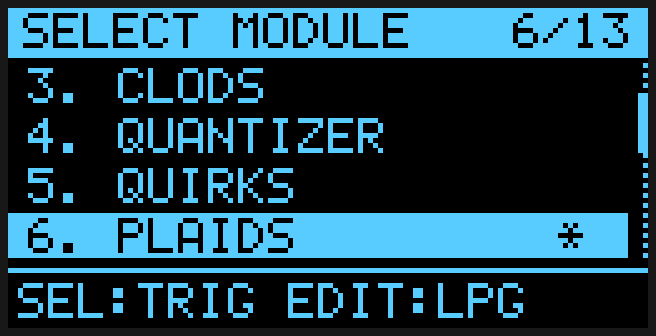 | 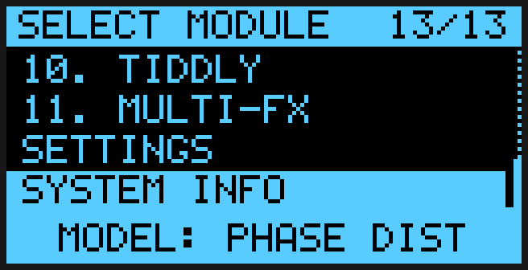 |
| **Module menu**: `*` marks the running module; the footer shows what SEL / EDIT / encoder do in the highlighted module | Menu scrolled to the end (Settings and System Info live after the 11 modules) |
| 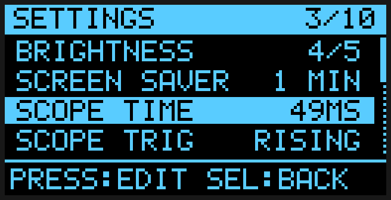 | 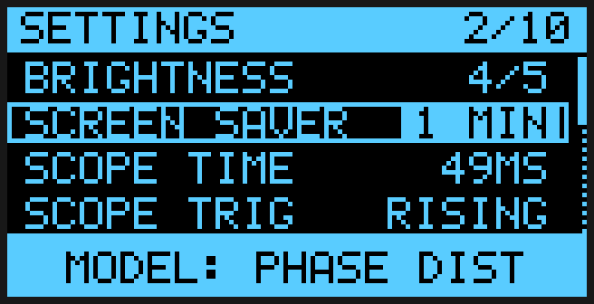 |
| **Settings** list | A setting in **edit mode** (value shown in an inverted chip) |
| 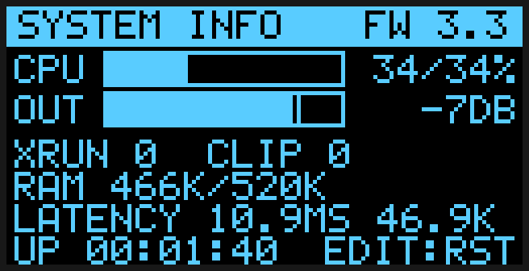 | |
| **System info**: CPU average/peak bar, output level, xruns, clips, RAM, latency, uptime | |

---

## 3. Hardware

Pin numbers are taken from `main.cpp` and `i2s.pio`. Codec facts were checked against the TI **PCM3060** datasheet. Items marked **(unverified)** are inferences, not facts from a datasheet or schematic. The board itself (schematic, pin map, analog stages, power) is documented in [`../hardware/README.md`](../hardware/README.md); where this section and that document overlap, the hardware README is derived from the schematic.

| Function | Detail |
|---|---|
| MCU | RP2350, system clock set to **144 MHz** (`set_sys_clock_khz(144000, true)`) |
| Audio codec | **TI PCM3060** (24-bit stereo ADC + DAC), I²C0 (GPIO 4 = SDA, GPIO 5 = SCL, 400 kHz), 7-bit address `0x46` (datasheet: `1000 11` + ADR pin, ADR low). Slave mode, 24-bit I²S. Configured by seven register writes in `main()` (`codec_init[]`, decoded in [§3.2](#32-pcm3060-register-writes)) |
| Codec master clock (SCKI) | PWM on **GPIO 14**: `wrap = 5`, `level = 3` → 144 MHz / 6 = **24.000 MHz = 512 × fs** (valid PCM3060 ratio; see [§3.1](#31-clocking-why-the-rate-is-46875-hz)) |
| I²S (from `i2s.pio`) | Two PIO state machines on `pio0` (SM0 = TX, SM1 = RX, started together with `pio_enable_sm_mask_in_sync`). The **RP2350 is the I²S master**: **BCLK = GPIO 10**, **LRCK/WS = GPIO 11** (both driven by the TX state machine via side-set), **DOUT = GPIO 13**, **DIN = GPIO 12**. BCLK = 64 × fs (3 MHz) |
| CV / control DAC | **MCP4728**, 4 channels, 12-bit, I²C0 address `0x60`, VDD (3.3 V) reference; written from the core-0 main loop. Outputs A and B give 0…≈8 V; C and D are inverting stages, so `dac_hw_code()` maps the modules' 0…4095 to 0…≈+4.9 V on those two channels ([§3.3](#33-cv-scaling-between-the-firmware-and-the-board)) |
| Analog inputs (ADC) | **MCP3208** on SPI0 (MISO 16, CS 17, SCK 18, MOSI 19, 1 MHz): channels 0–3 = **CV inputs 1–4** (bipolar around mid-scale), channels 4–7 = **pots 4–7**. RP2350 internal ADC: GPIO 26/27/28 = **pots 1–3** |
| Display | SSD1306-compatible 128×64 OLED, I²C1 (GPIO 2 = SDA, GPIO 3 = SCL, `OLED_I2C_HZ` = 400 kHz), address `0x3C` |
| Controls | `SELECT` button GPIO 0, `EDIT` button GPIO 1, rotary encoder A = GPIO 22, B = GPIO 21, encoder push = GPIO 20 (all active-low with pull-ups) |
| Misc | GPIO 23 is **only a test point on this board**. `main()` still drives it high at boot (`gpio_init/gpio_set_dir/gpio_put`, a leftover from the Raspberry Pi Pico reference design, where GPIO 23 selects the regulator's low-ripple PWM mode). Here it has no electrical function; it just holds the test point at 3.3 V. Safe to delete those three lines or to reuse the pin as a debug output |

### 3.1 Clocking: why the rate is 46,875 Hz

Everything derives from the one 144 MHz system clock, so SCKI, BCLK and LRCK are exactly frequency-locked (the PCM3060 requires this):

```
PIO clock  = 144 MHz / clkdiv 24            = 6.000 MHz      (i2s.pio, both TX and RX)
1 frame    = 2 channels x 32 bits x 2 PIO cycles = 128 PIO cycles
fs  (LRCK) = 6 MHz / 128                    = 46,875 Hz
BCLK       = 6 MHz / 2                      = 3.000 MHz  = 64 x fs
SCKI (MCLK)= 144 MHz / 6 (PWM, GPIO 14)     = 24.000 MHz = 512 x fs
```

* **`SAMPLE_RATE` in `main.cpp` must equal 46,875.** (It used to say 48,000, which made every pitch ~41 cents flat and all times 2.4 % long.) `tests/host/test_knobs.cpp` parses `i2s.pio` and fails if the two disagree.
* **Datasheet limits (PCM3060):** SCKI must be 256/384/512/768 × fs for the ADC (DAC also 128/192), **2.048–36.864 MHz**, 40–60 % duty cycle; ADC fs 16–96 kHz, DAC 16–192 kHz; BCK must be 64 × fs or 48 × fs in slave mode; SCKI/BCK/LRCK must be frequency-synchronous. The current setup satisfies all of these.
* **Should SCKI be 36.864 MHz? No.** 36.864 MHz is the datasheet *maximum* SCKI and equals 768 × 48 kHz. It is not required: any valid ratio works. It also cannot be made from the 144 MHz system clock (144 / 36.864 = 3.906…, which the PWM divider cannot represent), so choosing it would need a different clock source.
* **If you want exactly 48 kHz:** it needs an MCLK of 24.576 MHz (512 ×) or 36.864 MHz (768 ×) that is synchronous with the I²S clocks, i.e. an external 24.576 MHz or 12.288 MHz oscillator (feeding SCKI and/or the RP2350 clock input) or a system clock of 147.456 MHz (which the RP2350's PLL cannot produce from a 12 MHz crystal). Dividing the PIO by 23.4375 for 48 kHz while keeping a 24 MHz SCKI would break the 512 × relationship and is **not** recommended. If you do change the rates, change `SAMPLE_RATE`, `clkdiv` in `i2s.pio`, the SCKI divider and the scope labels together.

### 3.2 PCM3060 register writes

`codec_init[]` in `main()` writes these (register index decimal / hex, per the PCM3060 datasheet's mode-control register map):

| Write | Register | Value | Meaning |
|---|---|---|---|
| 1 | 64 (`0x40`) | `0x00` | Reset mode registers; ADC and DAC power-save cleared |
| 2 | 67 (`0x43`) | `0x00` | DAC: slave mode, 24-bit I²S |
| 3 | 68 (`0x44`) | `0x00` | DAC oversampling x64, no mute, normal phase |
| 4–5 | 65, 66 (`0x41/0x42`) | `0xFF` | DAC L/R attenuation 0.5 x (255 − 255) = **0 dB**. *(Was `0xF3` = −6 dB before this change, which cost about one bit of DAC dynamic range and made a dry pass-through 6 dB quieter than the input. Lower the code for an output trim: each step is 0.5 dB.)* |
| 6 | 69 (`0x45`) | `0x00` | DAC sharp roll-off filter, **de-emphasis off**. *(Was `0xD7` before rev 3.2, which turned on the 32 kHz de-emphasis (a treble roll-off; a standard 50/15 µs curve is roughly −10 dB at the top of the band) plus the slow filter; `0xD7` is the ADC attenuation default for register 70, so it was probably meant for another register.)* |
| 7 | 64 (`0x40`) | `0xC0` | MRST and SRST released, ADC/DAC running |

Not written, so at datasheet defaults: ADC attenuation (registers 70/71 = 0 dB), ADC format (register 72: slave, 24-bit I²S), ADC high-pass filter enabled (~1 Hz). The ADC and DAC each have their own SCKI/BCK/LRCK pin sets on the chip; this design is assumed to wire both to the same clocks (`CSEL` bits default to separate pins).

Signal path facts that matter for DSP code:

* Audio I/O is **stereo on the wire but the firmware is mono**: every engine reads only the **left** input word (`in_buf[i]`) and writes the **same** value to both output words. The right input is unused.
* Pots are read **inverted** (`1 - x`) so that clockwise = increasing.
* CV inputs are converted by `cv_from_counts()`: 12-bit counts, ±30-count dead-zone around `CV_IN_MID_COUNTS` (2048), **sign-flipped** because the input stage inverts, scaled to **−1…+1** where +1 is +5 V at the jack ([§3.3](#33-cv-scaling-between-the-firmware-and-the-board)). CV 1–4 are **added** to pot 1–4 of the active module (clamped to 0…1).

### 3.3 CV scaling between the firmware and the board

The CV stages on the DSP board (LB-SYNTH-PROTO-A v0.2) are not unity-gain and two of the four outputs invert, so `main.cpp` converts at the two edges. The derivation is in [`../hardware/README.md`](../hardware/README.md) §8; all values are nominal and **not yet measured on the board**.

| Direction | Hardware | Firmware |
|---|---|---|
| CV in A to D | Inverting stage, `Vadc = 1.5 V − 0.3 × Vin`, MCP3208 against 3.0 V: `counts = 2048 − 409.6 × Vin` (±5 V → 4095…0) | `cv_from_counts()`: `d = CV_IN_MID_COUNTS − counts`, ±30-count dead zone, result `−1…+1`, +1 = +5 V at the jack |
| CV out A, B | Non-inverting ×2.43 on the MCP4728 (VDD reference 3.3 V): 0…≈8.0 V | `dac_hw_code()` passes the code through |
| CV out C, D | Inverting summing stage: `Vout = 4.9 V − 5 × Vdac` (code 0 ≈ +4.9 V, high codes negative) | `dac_hw_code()` maps logical `0…4095` to `0…+CVOUT_CD_OFFSET_V` (≈ 0…+4.9 V); `cvout_cd_code_from_volts(v)` gives any voltage from about −5 to +4.9 V (bipolar CV, not used by the current modules) |

Calibration constants: `CV_IN_MID_COUNTS` (2048 nominal; about 2005 if the −12 V rail is −11.75 V), `CVOUT_CD_OFFSET_V` (4.9 V nominal, the −12 V rail × 100 k / 240 k), `DAC_VDD_V` (3.3 V, the Pico's regulator, not a precision reference). The full range of C and D is 1,216 DAC codes (about 10.2 bits) because C and D only use the lowest 0.98 V of the DAC's 3.3 V range; A and B have the full 12 bits.

The modules still just write `g_dac_out[]` in 0…4095 (the OLED bars show that logical value), so no module code changed.

---

## 4. Software architecture

### 4.1 Overview

```
                    CORE 1  (core1_ui_loop, ~3-30 ms per iteration)            CORE 0
  pots 1-3 (RP ADC) ─┐                                                    ┌──────────────────────────┐
  pots 4-7 (MCP3208)─┤  one-pole smoothing      g_param[7]   (atomic)     │ DMA IRQ0 (priority 0)    │
  CV 1-4   (MCP3208)─┼─► latch / pickup ─► + CV ─────────────────────────►│  process_audio_chunk()   │
  buttons, encoder ──┤                                                    │   params_begin_chunk()   │
         │           │  mode, submodes, triggers (atomics) ──────────────►│   switch(active_mode)    │
         ▼           │                                                    │    └ process_<x>_chunk() │──► tx buffer ► I2S ► codec
  UI state machine ──┤  ◄── g_cpu_*, g_xrun, g_clip, g_out_peak/rms ──────│   metering + scope ring  │
  (screens, menus)   │  ◄── g_scope_ring / g_scope_wr (lock-free) ───────│   crossfade on mode swap │
         │           │                                                    └───────────▲──────────────┘
         ▼           │                                                    rx buffer ◄──┘ (I2S ◄ codec)
  ui_render() ► oled_show() ► SSD1306 (I²C1)                              main() loop: g_dac_out[4] ► MCP4728 (I²C0)
```

* **Core 0** owns the real-time path. `main()` builds the hardware, enables the DMA interrupt, then loops forever pushing `g_dac_out[]` to the MCP4728 whenever `g_dac_dirty` is set.
* **Core 1** (`core1_ui_loop`) owns all human interface and slow I/O. It is launched with its own 8 KB stack (`core1_stack`).

### 4.2 Audio pipeline

* Four DMA channels (`dma_rx_0/1`, `dma_tx_0/1`) form two **chained ping-pong pairs** (0→1→0…). Each channel moves `CHUNK_32BIT_WORDS` (= 512) 32-bit words (256 stereo frames) between a PIO FIFO and `rx_buf_N` / `tx_buf_N`.
* When an RX buffer fills, `dma_audio_irq_handler` (DMA_IRQ_0, priority 0, placed in RAM with `__not_in_flash_func`) re-arms that channel pair and calls `process_audio_chunk(rx_buf_N, tx_buf_N)` while the *other* buffer is on the wire.
* **Latency** ≈ two chunks ≈ 10.9 ms plus codec delay (shown as "LATENCY 10.9MS 46.9K" on the System page).
* **Deadline:** `process_audio_chunk` must return within one chunk (5.46 ms, `CHUNK_DEADLINE_US`) or the DMA will replay stale data.
* `process_audio_chunk` also: measures CPU, crossfades on module change, meters the output, and writes a 2:1-decimated copy of the output to the scope ring (§4.5).

### 4.3 Control pipeline (pot → sound)

1. **Core 1** reads 7 pots (3 internal ADC channels × 8-sample average, 4 MCP3208 channels × 4-sample average) and 4 CV inputs.
2. Pots are smoothed with a **time-aware one-pole** (`a = 1 - exp(-dt/15 ms)`), so feel is independent of loop speed.
3. **Pickup/latch:** `RANDOMIZE` writes random targets and *latches* all pots; a pot only regains control after moving more than 0.05 from where it was.
4. **CV sum:** `param[i] = clamp(pot_or_latched[i] + cv[i], 0, 1)` for i = 0…3; i = 4…6 are pot only.
5. Result stored in `g_param[7]` (atomic floats, 0…1).
6. **Core 0**, once per chunk, `params_begin_chunk()` lag-filters each target (`sp_tgt += 0.35·(raw − sp_tgt)`) and computes a per-sample step; each sample `params_tick()` advances `sp[i]` linearly. This removes the 183 Hz "staircase" zipper noise.

Special case: in **Pim's** mode pot 7 sets tempo: `master_bpm = 40 + 210·param[6]` (computed on core 1).

### 4.4 Shared state between the cores

All are `std::atomic` unless noted. **Writer → reader** is shown; keep it that way.

| Variable | Type | Writer → Reader | Purpose |
|---|---|---|---|
| `active_mode` | int | UI → audio | Current module (`ModuleMode` enum) |
| `g_param[7]` | float | UI → audio | Pot + CV values, 0…1 |
| `g_cv[4]` | float | UI → audio | CV inputs, −1…+1 (used by Quantizer) |
| `g_dac_out[4]`, `g_dac_dirty` | uint16 / bool | audio → core-0 main loop | 12-bit CV outputs for the MCP4728 |
| `trigger_strike` | bool | UI → audio | One-shot trigger consumed with `exchange(false)` (Ringo, Plaids, Brains, Mumbles) |
| `trigger_dsp_clear` | bool | UI → audio | Ask Clods/FX to clear shared buffers on next chunk |
| `fx_trigger_pluck`, `quirks_sh_trig` | bool | UI → audio | One-shot triggers |
| `is_frozen` | bool | UI → audio | Freeze for Ringo / Clods / FX |
| per-module selectors | int / bool | UI → audio | `ringo_model_idx`, `clods_submode`, `selected_chord_type`, `root_note`, `quirks_audio_route`, `quirks_sh_use_audio`, `plaids_model`, `plaids_lpg_mode`, `brains_model`, `brains_bitcrush`, `mumbles_loop_len`, `wraps_algo`, `tiddly_shape_mode`, `fx_submode`, `selected_cv_out`, `master_bpm` |
| `g_cpu_load_pct`, `g_cpu_peak_pct` | float | audio → UI | Average / worst chunk over a 64-chunk (~350 ms) window |
| `g_xrun_count`, `g_clip_count` | uint32 | audio → UI | Chunks above 97 % budget; samples above 1.0 before the limiter |
| `g_out_peak`, `g_out_rms` | float | audio → UI | Output level (linear) |
| `g_scope_ring[4096]`, `g_scope_wr` | int16 / uint32 | audio → UI | Lock-free ring (single writer, release/acquire index) |

### 4.5 Scope and spectrum data path

The audio ISR averages every two output samples into `g_scope_ring` (**23.4 kHz**, 4096 samples = 175 ms). Core 1 reads it without locks:

* **Scope:** `draw_scope()` picks `stride` samples per pixel from `tb_stride[]`, finds a rising-edge trigger (hysteresis = 1/8 of the window peak) in a 512-sample search region, draws a min/max envelope per pixel column, and applies a gentle auto-gain (boost only, ×1…×16).
* **Spectrum:** `spectrum_update()` runs a Hann-windowed **512-point radix-2 FFT** on the newest 512 ring samples (45.8 Hz bins, 0…11.7 kHz), maps bins to 42 log-spaced bars (interpolating where a bar is narrower than a bin), smooths them with a selectable fall speed, and tracks peak caps. A parabolic fit gives the peak-frequency read-out.

### 4.6 Memory budget

Static RAM ≈ **466 KB of 520 KB** (computed in `g_sram_static_bytes`; shown on the System page). Largest items:

| Buffer | Size | Notes |
|---|---|---|
| `record_buffer` | 366 KB (93,750 floats = 2 s mono) | Shared by **Clods** and the **FX echo** — never run both at once (module change clears it) |
| Reverb (`rev_comb_mem`, `rev_ap_mem`) | ≈ 54 KB | 8 combs + 4 all-passes |
| Scope ring | 8 KB | |
| FFT work + tables | ≈ 10 KB | |
| `core1_stack` | 8 KB | UI code uses `snprintf` with floats |
| DMA buffers | 8 KB | 4 × 2 KB |
| Chorus buffer | 8 KB | 2048 floats |
| OLED buffers | 2 KB | `oled_buf` + `oled_prev` |

Remember the SDK, stacks and any new feature also need RAM. If you need more, shorten `BUFFER_SECONDS` first.

---

## 5. Code map

`main.cpp` has six sections; search for the banner comments `// N. TITLE`.

| § | Banner | Contents |
|---|---|---|
| header | — | Revision notes and includes |
| 1 | `GLOBAL SYSTEM & HARDWARE DEFINITIONS` | Constants (`SAMPLE_RATE`, `CHUNK_SAMPLES`, pins), `ModuleMode` enum, name tables (`mode_titles`, `mode_short_names`, `mode_param_names`), **all shared atomics**, per-module state declarations and name tables |
| 2 | `MATH / AUDIO HELPERS & OLED DRIVER` | `clamp`, `soft_limit`, `fast_tanh`, `xrand/rnd01/rnd_bi`, `xfade`, `dc_block`, `in_to_float`, `write_stereo`, `read_behind_hermite`, `poly_blep`, `blep_square`, Hann table, ADC/SPI/DAC access (`read_mcp3208*`, `read_adc_avg`, `cv_from_counts`, `update_mcp4728_channel`), SSD1306 driver + drawing primitives (`oled_px`, `oled_fill_rect`, `oled_print*`, `oled_show` with page-diff, `g_ink` inversion) |
| 3 | `USER INTERFACE: VIEWS, MENUS, SCOPE / SPECTRUM` | UI enums/state, settings struct `cfg`, FFT + spectrum, `draw_scope`, `draw_spectrum`, `draw_level_bar`, header/views (`draw_header`, `draw_view_*`, `draw_play`), overlays (`draw_toast_bar`, `draw_param_overlay`), generic list renderer `draw_list`, menu/settings/system screens, `draw_splash` |
| 4 | `DSP ENGINES` | `params_begin_chunk/params_tick`, `quantize_semitone`, then `process_{pims,ringo,clods,quantizer,quirks,plaids,brains,mumbles,wraps,tiddly,fx}_chunk`, then `process_audio_chunk` (dispatcher + metering) and `dma_audio_irq_handler` |
| 5 | `CORE 1: UI, INPUT & CONTROL SCANNING` | Interrupt-driven encoder decoder, button debouncer (`Btn`, `btn_update`), `switch_module`, `module_encoder`, `ui_render`, and `core1_ui_loop` |
| 6 | `MAIN SYSTEM STARTUP` | Clock, MCLK PWM, codec init, PIO + DMA set-up, DMA IRQ, then the DAC-output loop |

---

## 6. DSP conventions and the engine contract

### 6.1 Engine contract

```cpp
void process_<name>_chunk(int32_t* in_buf, int32_t* out_buf);
```

* Both buffers are **interleaved stereo 32-bit words**, `CHUNK_32BIT_WORDS` (= 512) long: index `i` = left, `i+1` = right. Loop `for (int i = 0; i < CHUNK_32BIT_WORDS; i += 2)`.
* Read input with `in_to_float(in_buf[i])` (returns −1…+1). Most engines then call `dc_block()`.
* Call `params_tick()` once at the top of each iteration, then read `sp[0..6]`.
* Write output with `write_stereo(out_buf, i, x)`.
* Chunk-rate setup (anything per chunk, e.g. `powf` for a filter coefficient) goes **before** the loop using `sp_tgt[]`; interpolate to the per-sample value if it must be smooth.
* Engine state is `static` file-scope data. State is **not reset when you leave a module** (see [§12](#12-known-issues-unverified-assumptions-and-ideas)).
* Optional CV outputs: write `g_dac_out[0..3]` (0…4095, the *logical* value) and set `g_dac_dirty`. The core-0 loop converts each channel with `dac_hw_code()` before it reaches the DAC, so write the same convention to all four channels. Outputs are updated once per chunk (183 Hz).

### 6.2 Helpers worth knowing

| Helper | Behaviour |
|---|---|
| `soft_limit(x)` | Transparent (unity slope) below \|x\| = 0.7, smoothly approaches ±1 above. Applied last in `write_stereo` |
| `fast_tanh(x)` | Rational tanh, unity slope at 0, clamped at ±3 |
| `xfade(m, dry, wet)` | Equal-power gains. **Use a linear mix instead when dry and wet are correlated** (see Quirks) |
| `dc_block(x)` | One-pole high-pass ≈ 1.5 Hz on a **single global state** (`dc_offset`) shared by all engines |
| `read_behind_hermite(buf, len, w, delay)` | 4-point Hermite fractional-delay read, `delay` in samples behind write index `w` |
| `poly_blep`, `blep_square` | Band-limited saw/square edges (PolyBLEP) |
| `adaa_abs(u, u1)` | First-order antiderivative anti-aliased `\|u\|` (Quirks) |
| `quantize_semitone(semis, root, chord, max)` | Nearest note in a scale/chord (Quantizer, Mumbles) |
| `xrand()/rnd01()/rnd_bi()` | xorshift RNG, **audio ISR only** |

---

## 7. Modules

Eleven modules, indexed by `ModuleMode` (default at boot: **Clods**). Each has **7 parameters** (pots 1–7) plus a model/mode selector on the encoder and optional SELECT/EDIT actions.

### 7.1 Parameter map

Columns are pots 1–7 (CV 1–4 modulate pots 1–4). Every labelled knob is now wired to something (the last three dead ones were fixed in rev 3.2; see the module notes).

| # | Module | P1 | P2 | P3 | P4 | P5 | P6 | P7 |
|---|---|---|---|---|---|---|---|---|
| 0 | Pim's CV | GATE WIDTH | EUCLID STEP | WAVE SHAPE | PHASE OFFSET | SLEW SMOOTH | AUDIO CHOP | BPM / TEMPO |
| 1 | Ringo | FREQUENCY | STRUCTURE | BRIGHTNESS | POSITION | MODEL MORPH | FEEDBACK | WET/DRY MIX |
| 2 | Clods | POSITION | GRAIN SIZE | PITCH | DENSITY | TEXTURE | FEEDBACK | WET/DRY MIX |
| 3 | Quantizer | TRANSPOSE | CHORD SPREAD | OCTAVE RNG | GLIDE SLEW | OSC DETUNE | FM TIMBRE | WET/DRY MIX |
| 4 | Quirks | S&H RATE | DRIVE | BLEND | NOISE LEVEL | LPF CUTOFF | THRESHOLD | WET/DRY MIX |
| 5 | Plaids | PITCH | HARMONICS | TIMBRE | MORPH | FM AMOUNT | LPG DECAY | OUTPUT LVL |
| 6 | Brains | PITCH | TIMBRE | COLOR | MOD DEPTH | MOD RATE | DRIVE CRUSH | OUTPUT LVL |
| 7 | Mumbles | CLOCK RATE | V-SPREAD | DEJA VU | ROOT BIAS | QUANT SCALE | GATE DECAY | OUTPUT LVL |
| 8 | Wraps | CARRIER FRQ | FOLD DEPTH | MOD GAIN | TIMBRE | INT/EXT CAR | FEEDBACK | WET/DRY MIX |
| 9 | Tiddly | FREQ RATE | SLOPE SHAPE | SMOOTHNESS | WAVE FOLD | FM DEPTH | AUDIO MOD | OUTPUT LVL |
| 10 | Multi-FX | CHORUS DPTH | CHORUS RATE | ECHO TIME | ECHO FDBK | REVERB DECY | REVERB DAMP | WET/DRY MIX |

### 7.2 Controls per module

| Module | Encoder turn | SELECT (tap) | EDIT |
|---|---|---|---|
| Pim's CV | Clock multiply/divide of the selected channel (−32…−2 = divide, 1…32 = multiply) | Next CV channel | Next waveform shape (10) |
| Ringo | Model (6) | Strike | Freeze |
| Clods | Sub-mode GRAIN / LOOP / WASH | Randomise all parameters | Freeze |
| Quantizer | Scale/chord type (8) | Next root note | — |
| Quirks | Route RECT/INV, MAX/MIN, S&H+NOISE | Trigger the S&H | S&H source: audio ↔ internal noise |
| Plaids | Model (4) | Trigger envelope | Toggle LPG ↔ drone (retriggers) |
| Brains | Model (4) | Accent trigger | Toggle bit-crush |
| Mumbles | Loop length 2…16 steps | Manual clock/trigger | — |
| Wraps | Algorithm (4) | — | — |
| Tiddly | Mode (3) | — | — |
| Multi-FX | Sub-mode ALL / CHORUS / ECHO / REVERB | **Tap** = test pluck, **hold ≥ 0.6 s** = randomise | Freeze |

### 7.3 Module notes

**0 · Pim's CV** — four modulation channels running at integer multiples/divisions of `master_bpm`. 10 shapes (gate, triangle, sine, exponential, log decay, saw, trapezoid, random S&H, random wander, Euclidean). Each channel's slewed value goes to a DAC output (**sampled once per chunk**). AUDIO CHOP amplitude-modulates the audio input with channel 1. **WAVE SHAPE** skews the continuous shapes (TRI, SINE, EXP, LOG, SAW, TRAP) by moving the half-way point of the cycle with a piecewise-linear phase warp (12 o'clock = unchanged, small dead-zone; TRI becomes ramp-up/ramp-down at the extremes, SAW's mean level and SINE's peak position move; GATE, S&H, WANDER and EUCLID keep their own timing).

**1 · Ringo** — bank of **4 resonant modes** (coupled-form "magic circle" oscillators). The model sets the mode frequency ratios (strings, sympathetic, tube, inharmonic bell, FM-modulated, chord). BRIGHTNESS sets decay time (50 ms…4 s, higher modes decay faster). A **strike** injects energy directly into the mode states at a decay-independent level. Audio input drives the modes through an **input AGC** that steeply reduces gain once the resonators get loud; the feedback path uses the same gain, so it sustains/self-oscillates but cannot run away. Freeze pushes damping to ≈ 1. **MODEL MORPH** crossfades the mode-frequency ratios (and the FM wobble) from the selected model toward the *next* model (wrapping 5 → 0): 0 = the selected model exactly, 1 = identical to the next model (checked by `test_knobs`), in between = inharmonic hybrids. Mode ratios are ramped per sample, so moving STRUCTURE or MORPH does not step.

**2 · Clods** — granular processor over a **2 s** mono buffer, up to **16 grains**, Hann window, linear-interpolated reads. The scheduler runs inside the audio engine (sample-accurate, no cross-core race). Sub-modes: GRAIN, LOOP/FREEZE (Hermite read at a glided loop length), WASH (long grains, large pitch scatter). Grain lengths are bounded so a read head cannot overtake the write head; output normalisation is smoothed `1/√active`. Freeze stops recording. Shares `record_buffer` with FX.

**3 · Quantizer** — quantises CV 1 and CV 2 to the selected scale/chord (`quantize_semitone`) and plays them with a small 2-voice sine/FM voice with glide. DAC: out 0 = note A, out 1 = note B, out 2 = 10 ms gate on note change, out 3 = glided pitch. (The old code quantised the *audio amplitude*; it now quantises CV.)

**4 · Quirks** — three routes. Signal flow: input → DC block → **DRIVE** (bounded saturator: clean at 0, saturated at 1, always within ±1) → route → DC removal (routes 0/1) → soft limit → LPF → **linear** dry/wet mix.
* *RECT/INV*: crossfade `−y ↔ |y|` (anti-aliased with first-order ADAA).
* *MAX/MIN*: crossfade `min(y, thr) ↔ max(y, thr)` — a one-sided clipper (half-wave rectifier when THRESHOLD is centred).
* *S&H+NOISE*: sample-and-hold of audio (or noise) with the noise added exactly once; the clock is **exponential 0.1 Hz…2 kHz**; SELECT triggers manually.
* LPF cutoff: **knob up = brighter**, 200 Hz…20 kHz exponential.
* DAC: out 0 = |y|, out 1 = max(y, thr), out 2 = min(y, thr), out 3 = S&H value.

**5 · Plaids** — four models: *VA* (PolyBLEP triangle/saw/square morph), *phase distortion*, *2-operator FM* (index falls with pitch to limit aliasing), *chord machine* (4 sines). LPG-style decaying envelope with ~1 ms de-click smoothing; audio input FM-modulates the pitch.

**6 · Brains** — four models: *CSAW* (PolyBLEP saw with notch), *supersaw swarm* (4 detuned PolyBLEP saws), *vowel formant* (two windowed sine partials; a simplification), *metallic bell* (FM). Always adds a PolyBLEP sub-oscillator, a `fast_tanh` drive and optional bit-crush; LFO modulates pitch.

**7 · Mumbles** — random clock, a 16-step "déjà vu" loop memory (`mumbles_step_cache`), pitch quantised to one of 8 scales with `quantize_semitone`, driving a small FM sine voice. DAC: out 0 and 1 = pitch, out 2 = gate, out 3 = envelope.

**8 · Wraps** — carrier (internal oscillator ↔ audio input) and modulator (audio input). Algorithms: *wavefolder* (first-order ADAA sine folder), *"thru-zero" FM* (bounded phase modulation — **not** true thru-zero), *ring modulator*, *"vocoder"* (a simple carrier·modulator product — **not** a real vocoder). Output is `fast_tanh`-limited and also fed back.

**9 · Tiddly** — AD/AR envelope, slope-shaped LFO or step function at `FREQ RATE`, driving an audio-rate sine oscillator with envelope-controlled FM and **waveshaped** folding (the earlier phase-multiplier fold was discontinuous). **SMOOTHNESS** is a one-pole slew (≈ 0.4 ms … ≈ 45 ms) on the envelope that drives the VCA, the FM and CV out 1, so steps become ramps and a fast cycle becomes a soft swell. DAC: out 0 = the smoothed envelope, outs 1–3 = phase-offset ramps (+¼, +½, +¾).

**10 · Multi-FX** — chorus (2 Hermite taps), tape echo (Hermite read with wow, low-pass in the feedback loop, 0.03…1.6 s), Freeverb-style hall (**8 damped combs → 4 all-passes**). Sub-modes route to all three or one. Freeze holds the echo/reverb. A built-in FM "test pluck" voice (SELECT tap) lets you hear the effect without an input.

---

## 8. User interface

### 8.1 Controls

| Control | In play screen | In menus |
|---|---|---|
| **Encoder turn** | Module-specific selector ([§7.2](#72-controls-per-module)) | Move cursor / change value while editing |
| **Encoder short press** | Open the module menu | Select / enter / toggle edit |
| **Encoder long press** (≥ 0.6 s) | **Cycle the view**: Parameters → Scope → Spectrum → Scope+Spectrum | — |
| **SELECT** | Module action ([§7.2](#72-controls-per-module)) | **Back** (one level) |
| **EDIT** | Module action | System-info page: reset stats. SELECT or encoder press returns to the menu |
| **Move any pot** | Parameter overlay for 1.6 s | Wakes the screen |

Menus return to the play screen after **30 s** of inactivity.

### 8.2 Screens

State is `ui_screen` ∈ {`SCR_PLAY`, `SCR_MENU`, `SCR_SETTINGS`, `SCR_SYSTEM`}; the play view is `ui_view` ∈ {`VIEW_PARAMS`, `VIEW_SCOPE`, `VIEW_SPECTRUM`, `VIEW_COMBO`}.

* **Header (row 0–9):** inverted module name; sub-mode text (truncated to the room left); right side tags: `CLIP` (recent over), `FRZ` (frozen), CPU %. The CPU tag is inverted when the average exceeds 85 % or an xrun occurred in the last 3 s.
* **Module menu:** 11 modules + `SETTINGS` + `SYSTEM INFO` (13 items), 4 rows visible, scroll bar, footer = per-module controls hint.
* **Settings:** see below. **System info:** CPU average bar with peak tick (3 s hold), output level bar, xrun/clip counters, RAM, latency, uptime.
* **Toast:** inverted bar at the bottom for 1.4 s (`ui_toast(fmt, ...)`, max 20 chars). Entering a module shows its control hint.

### 8.3 Settings

RAM only (reset at power-up; see [§12](#12-known-issues-unverified-assumptions-and-ideas)). Struct `Settings cfg`.

| Setting | Values | Default |
|---|---|---|
| BRIGHTNESS | 1–5 (OLED contrast `0x10…0xFF`) | 4 |
| SCREEN SAVER | OFF / 30 s / 1 min / 5 min (display off after inactivity; any input wakes it and is swallowed) | 1 min |
| SCOPE TIME | 5, 11, 22, 33, **49**, 66, 87, 131 ms across the screen | 49 ms |
| SCOPE TRIG | RISING / FREE | RISING |
| SPECTRUM | FAST / MEDIUM / SLOW fall speed | MEDIUM |
| PEAK HOLD | ON / OFF (spectrum caps) | ON |
| ENCODER | NORMAL / SLOW / SLOWER (1 step per 1/2/3 detents) | NORMAL |
| RESET STATS | action: clears xrun/clip counters and CPU peak | — |
| CLEAR BUFFERS | action: sets `trigger_dsp_clear` | — |
| BACK | action | — |

### 8.4 Rendering internals

* `core1_ui_loop` calls `ui_render(mode, now)` at 30 ms (animated views) or 60 ms (static screens), never faster than 20 ms. `ui_render` clears `oled_buf`, calls the `draw_*` functions for the current screen, then `oled_show()` sends **only the 8-pixel pages that changed** (`oled_prev` diff) — static screens cost almost no I²C time.
* The 5×7 font (`font5x7[]`) covers ASCII 32–90. `g_ink = 0` draws in "erase" mode, which is how inverted text on a filled rectangle is done (`g_ink = 1` afterwards!).
* **Encoder:** GPIO interrupt on **both pins, both edges** feeds a cycle-position decoder (`enc_feed`, written for this project). It tracks where the pins are in the Gray-code cycle (`11 → 01 → 00 → 10 → 11` = one clockwise detent; rest = `11`), keeps a running total of quarter-steps, and emits a count only when it returns to rest with a net of exactly ±4. Bounce nets out, half-turns that reverse cancel, a missed edge mid-turn is inferred from the direction already travelling, and an unexplainable jump drops that one excursion. Result: exactly **one step per detent**; direction convention: A falling while B high = clockwise. It assumes a detent at the `11` rest state (a full cycle per click); an encoder with a click at every quarter or half cycle would feel as if it needed several clicks per step. The `ENCODER` setting divides steps on core 1.
* **Buttons:** 25 ms debounce, press / release / long-press (600 ms) events via `Btn` + `btn_update`.

---

## 9. Audio-quality design decisions

These choices explain *why* the code looks the way it does. Preserve them when editing.

| Topic | Decision | Reason |
|---|---|---|
| Word length | Full 32-bit words in and out (`in_to_float`, `write_stereo`); no `& 0xFFFF0000` truncation | Undithered 16-bit truncation made reverb/echo tails grainy |
| Output limiting | `soft_limit()` with a 0.7 knee, unity below | The old cubic clipper had 1.5× gain at zero and coloured every signal, even dry |
| Parameter smoothing | Per-sample linear ramps (`sp[]`) toward a lag-filtered target | A 256-sample staircase = 183 Hz zipper noise |
| Pot/CV reads | Oversampled + time-aware smoothing, continuous CV dead-zone | ADC jitter on a pitch pot is directly audible |
| Oscillators | PolyBLEP saws/squares | Naive waveforms alias badly |
| Non-linearities | ADAA for `\|x\|` (Quirks) and the sine folder (Wraps); FM index falls with pitch (Plaids/Brains) | Aliasing |
| Delay lines | Hermite interpolation; 8-comb + 4-all-pass reverb | Linear interpolation dulls echo/chorus; 4 combs sounded thin |
| Gain staging | **Every stage bounded to ±1 before the mix**; use a *linear* mix for correlated dry/wet; remove DC created by rectifiers | Quirks used to clip because gain compounded (drive 3.5× × +3 dB mix × DC) |
| Resonators | Input **AGC** keyed on the resonator output (Ringo) | A high-Q resonator driven at its own frequency has gain ≈ 1/√(1−damping) (hundreds ×) |
| Module change | Crossfade from the previous engine's last sample over the first chunk | Pop on switching |
| Safety | NaN guard in `write_stereo`; Ringo resets its modes if the output exceeds ±8 | A NaN in a feedback path would otherwise persist |
| Grain engine | Scheduling inside the audio engine, `active` flag set last | A cross-core race could produce a zero-length grain → divide by zero → NaN |

---

## 10. Testing

`tests/host` compiles `main.cpp` on a PC against **stub SDK headers** (`tests/host/stubs`) and drives the real engines and UI code. `host_common.inc` provides stub implementations and a **fake clock**: `time_us_32()` advances by `next_cost` µs on every second call, which lets tests simulate chunk cost.

```bash
cd tests/host
./run_tests.sh            # builds and runs all tests (g++ only)
./run_tests.sh screens    # also regenerates docs/img/*.png (needs Python + Pillow)
```

| Test | What it asserts |
|---|---|
| `test_cpu_stats` | Windowed CPU average is stable under jitter; one 105 % chunk counts exactly one xrun; the spike on a module switch is excluded by the warm-up |
| `test_ringo` | No pre-limiter overs in spot checks; across **648** combinations (6 models × 4 inputs × 3 pitches × 3 brightness × 3 feedback) at most one marginal case (an in-tune 0.6 FS sine, shortest decay, feedback at maximum) |
| `test_quirks` | 5,832-combination extreme grid at 0.95 FS: zero overs; DC small; mix = 0 reproduces the input to < 0.005; S&H rate within 15 % of 0.1·20000^k Hz; LPF knob direction; ADAA reduces non-harmonic energy ≥ 3 dB vs. naive `\|x\|` |
| `test_encoder` | Clean detents, bounce (up to 8 flaps per edge, 2,000 random detents), long chatter at rest, mid-turn reversal, a missed edge mid-turn (direction inferred), an unexplainable jump (dropped, and the next detent still counts), repeated samples and power-up between detents all give exactly the right count and sign. Prints the old edge-counting scheme alongside for comparison |
| `test_knobs` | **Pim's WAVE SHAPE** (triangle rising fraction 0.04 / 0.23 / 0.50 / 0.77 / 0.96 across the knob, sine peak moves, saw mean level 0.69 / 0.50 / 0.31, GATE unaffected, DAC always in range). **Ringo MODEL MORPH** (morph 0 ≠ morph 1, morph 1 ≡ next model for all six models, no pre-limiter overs in 60 runs). **Tiddly SMOOTHNESS** (CV swing shrinks monotonically, 0.87 → 0.77 → 0.22). **Hardware constants** (`SAMPLE_RATE` equals what `i2s.pio` generates, MCLK/fs = 512, PCM3060 register `0x45` has de-emphasis off, scope labels match the rate) |
| `test_cvmap` | **CV scaling against a model of the analog stages** from the schematic: outputs A/B pass through (0…≈8 V); outputs C/D follow the logical value as a rising 0…≈4.9 V ramp (low gate ≈ 0 V, high gate ≈ +4.9 V), monotonic, within two DAC steps, zero point within 150 mV over a ±0.25 V rail change; the bipolar helper hits −5…+4.9 V; CV inputs read positive for positive volts (≈ Vin/5), fall monotonically with counts, show no jump at the dead-zone edge, and an unpatched jack reads ≈ 0 |
| `render_screens` | Produces the documentation screenshots |

**Limits of these tests:** they run on an x86 PC (different `libm`, no timing realism, no codec, no real I²S). They verify *logic, levels and bounds*, not on-device CPU load, clock accuracy or sound. Measure CPU on the board with the System page.

**Adding a test:** copy the header of an existing `test_*.cpp` (`#include "host_common.inc"`, `#define main fw_main`, `#include "../../main.cpp"`, `#undef main`), write helpers that call `process_audio_chunk()` with a synthetic input, print results, and return non-zero on failure. Add the file to the loop in `run_tests.sh`.

---

## 11. Building, and extending the code

### 11.1 Build

The repository root is the project root: `CMakeLists.txt`, `main.cpp` and `i2s.pio` live side by side, and the build is run from a `build/` sub-folder (`cd build && cmake .. && make`).

You need the Pico SDK with RP2350 support, and `pico_sdk_import.cmake` copied next to `CMakeLists.txt` (from `$PICO_SDK_PATH/external/`). The project file as supplied by the author:

```cmake
cmake_minimum_required(VERSION 3.13)

include(pico_sdk_import.cmake)
project(dev_dsp_module C CXX ASM)
pico_sdk_init()

add_executable(dev_dsp 
    main.cpp
)

# Compile the PIO assembly into a C++ header
pico_generate_pio_header(dev_dsp ${CMAKE_CURRENT_LIST_DIR}/i2s.pio)

# Link essential hardware libraries
target_link_libraries(dev_dsp 
    pico_stdlib pico_multicore
    hardware_i2c hardware_spi hardware_pio hardware_dma hardware_irq
    hardware_pwm hardware_clocks hardware_adc hardware_flash hardware_sync
)

pico_enable_stdio_usb(dev_dsp 1)
pico_enable_stdio_uart(dev_dsp 0)
pico_add_extra_outputs(dev_dsp)
```

Notes:

* The file does **not** set `PICO_BOARD`/`PICO_PLATFORM`; pass them when configuring (for an RP2350 board, e.g. `cmake -DPICO_BOARD=pico2 ..`) or export them in the environment. Use the board definition that matches your hardware.
* `hardware_flash` is linked but currently unused (it is there for a future settings store; see [§12](#12-known-issues-unverified-assumptions-and-ideas)). USB stdio is enabled, UART stdio is off.
* Build in **Release** (`-DCMAKE_BUILD_TYPE=Release`): Debug builds are much slower and will cause xruns. The UI uses `snprintf` with floats; keep newlib float support enabled.
* This repository's host tests do not use CMake; see [§10](#10-testing).

### 11.2 Tunable constants

| Constant | Where | Meaning |
|---|---|---|
| `SAMPLE_RATE`, `CHUNK_SAMPLES` | §1 | Audio rate and block size (changing `CHUNK_SAMPLES` changes latency, CPU margin and all per-chunk logic; `SCOPE_FS` derives from `SAMPLE_RATE`) |
| `BUFFER_SECONDS` | §1 | Clods/echo buffer length (RAM!) |
| `OLED_I2C_HZ` | §1 | Try 1 MHz for a faster scope if your display tolerates it |
| `CPU_WINDOW_CHUNKS` | §1 | CPU averaging window |
| `tb_stride[]`, `tb_names[]`, `NUM_TIMEBASES` | §3 | Scope timebases (max ≈ 131 ms with the 4096-sample ring; labels are checked against `SAMPLE_RATE` by `test_knobs`) |
| `cfg` initialiser | §3 | Default settings |
| `kRingoInGain`, AGC knee `0.05f` | §4 (Ringo) | Ringo input level and AGC threshold |

### 11.3 Checklist: adding a module

1. Add `MODE_NEW` to `ModuleMode` **before** `NUM_MODES`.
2. Add entries (same index) to `mode_titles`, `mode_short_names`, `mode_param_names[][7]` (§1) and `mode_hints` (§3).
3. Declare state + selector atomics (§1) and name tables if it has models.
4. Write `process_new_chunk()` obeying [§6.1](#61-engine-contract); end every sample with `write_stereo`.
5. Add a `case MODE_NEW:` to the `switch` in `process_audio_chunk`.
6. UI hooks: a `case` in `mode_sub_label` (header text), `module_encoder` (encoder action), and the SELECT/EDIT branches in `core1_ui_loop` (play-screen handling). The menu grows automatically (`MENU_N = NUM_MODES + 2`).
7. If it uses `record_buffer`, add it to the clear rule in `switch_module` (`next == MODE_CLODS || next == MODE_FX`).
8. If it drives CV, write `g_dac_out[]` and `g_dac_dirty` — and remember outputs persist after you leave the module ([§12](#12-known-issues-unverified-assumptions-and-ideas)).
9. Add a host test that sweeps its parameters and asserts no overs; run `./run_tests.sh`.
10. Check the RAM budget on the System page and CPU peak on hardware.

### 11.4 Checklist: adding a setting or a view

*Setting:* add a field to `Settings` and the `cfg` initialiser; add a label to `set_labels[]`, bump `SET_N`, keep the `SET_*` action indices (`SET_RESET`, `SET_CLEAR`, `SET_BACK`) after the value settings; handle it in `set_value()` and `set_adjust()`.

*View:* add to the `View` enum and `view_names[]`, write a `draw_view_*()` that draws into rows 12–63 (header owns rows 0–9), and add a `case` in `draw_play`. Mark whether it is animated in the render-interval logic inside `core1_ui_loop` (`animated`).

### 11.5 Using this as a foundation for different firmware

The code separates cleanly into reusable layers:

* **Hardware bring-up** (§6 `main()`): clock, MCLK, codec init, PIO I²S, ping-pong DMA, IRQ. Reusable for any I²S codec with changes to `codec_init[]`, pins and `i2s.pio`.
* **Real-time framework** (`process_audio_chunk`, parameter ramps, metering, scope ring): keep as is; replace the engines.
* **Control scanning** (core 1 loop: pots, CV, latch, buttons, encoder): keep; change `NUM_MODES` and name tables.
* **UI toolkit** (§2 primitives + §3): `draw_list`, toasts, overlays, scope/spectrum are generic.
* **Engines**: each is independent; copy the contract in [§6.1](#61-engine-contract).

---

## 12. Known issues, unverified assumptions and ideas

### 12.1 Verify on hardware (assumptions)

1. **Real LRCK / SCKI frequencies.** By calculation from `i2s.pio` and `main.cpp` they are 46,875 Hz and 24.000 MHz (512 ×), which the PCM3060 accepts ([§3.1](#31-clocking-why-the-rate-is-46875-hz)). Confirm with a scope or frequency counter on LRCK (GPIO 11) and SCKI (GPIO 14); if LRCK is not 46.875 kHz, `SAMPLE_RATE` is wrong and pitches will be off.
2. **Codec configuration.** Register values were decoded against the datasheet ([§3.2](#32-pcm3060-register-writes)) but not tested on the board. Check by ear and on a scope: (a) removing the de-emphasis (`0x45`: `0xD7` → `0x00`) should sound brighter; (b) the DAC attenuation is now 0 dB (`0xFF`, was −6 dB), so the output is 2x the voltage it was. From the schematic the output stage is a differential-to-single-ended TL072 with gain x1.2, so DAC full scale (8 Vpp differential at 5 V analog supply, per the datasheet) becomes about 9.6 Vpp (±4.8 V peak) at the jack, which the op-amp can deliver on ±12 V rails; confirm on a scope ([`../hardware/README.md`](../hardware/README.md) §7.3). The schematic wires `VOUT±` to the differential output buffer, which matches the differential output mode written to register 64, and the ADC and DAC share one clock set.
3. **CPU load on the target.** Host tests cannot measure it. Use the System page (average/peak, xruns) in each module, especially Clods and Multi-FX.
4. **CV scaling constants** (`CV_IN_MID_COUNTS`, `CVOUT_CD_OFFSET_V`, `DAC_VDD_V`) are nominal values derived from the schematic and checked only against a model ([§3.3](#33-cv-scaling-between-the-firmware-and-the-board)). Measure on the board: with the CV jacks unpatched (the jack switch grounds them, see [`../hardware/README.md`](../hardware/README.md) §10.4) read the raw counts and set `CV_IN_MID_COUNTS`; command logical 0 on CV Out C and D and trim `CVOUT_CD_OFFSET_V` until the jack reads 0 V; check CV Out A/B full scale (expect ≈ 8.0 V).

### 12.2 Known limitations

* **Mono:** the right input is ignored and the output is dual-mono. Going stereo means separate L/R processing in the FX (reverb taps, chorus taps, a second echo buffer — RAM!) and roughly 2× CPU.
* **Tiddly audio path can exceed full scale.** In AUDIO MOD the VCA path is `in x envelope x (1 + FOLD)`, so a hot input (~0.9 FS) with FOLD at maximum exceeds ±1 before the output limiter (the limiter catches it, audibly saturating). Not changed in rev 3.2; `test_knobs` uses a 0.4 FS input for this reason.
* **Wrong-rate side effect (fixed):** before rev 3.2, delay/echo times, grain sizes, LFO rates and every pitch ran 2.4 % off because `SAMPLE_RATE` was 48,000.
* **CV outputs update once per chunk (183 Hz)**, so fast S&H/audio-derived CVs are sampled coarsely. Modules that do not use the DAC leave the **last values latched** from the previous module.
* **Settings are not persisted.** Flash writes stall the XIP bus; the audio ISR and most engine code run from flash (only the dispatcher/ISR are `__not_in_flash_func`), so a naïve flash save could crash audio. A safe design needs the ISR and engines in RAM (RAM is nearly full) or a multicore lock-out.
* **Engine state persists across module switches** (statics are never reset except Clods/FX buffers) so returning to a module may resume with stale resonator/filter state. The first chunk after a switch crossfades from the previous module's last sample only (no tail of the old engine).
* **`dc_block` state is global** (`dc_offset`) and shared by all engines.
* **Cross-core exceptions to Rule 2:** `cv_channels[]` (Pim's shape/ratio), `mumbles_step_cache` and some `static` UI-adjacent arrays are edited by core 1 while core 0 reads them (benign torn reads of small integers/floats, but not formally safe).
* **`rand()`** is used on core 1 (`randomize_params`); it must never be called from the audio path.
* **Ringo:** one marginal pre-limiter over remains in the stress grid (in-tune 0.6 FS sine, shortest decay, feedback at maximum; output peak 0.85 after the limiter).
* **Names vs behaviour:** Wraps "thru-zero FM" and "vocoder" are simplified (see §7.3). Brains' "vowel formant" is a two-partial approximation.
* **UI loop timing:** pots/CV are scanned once per loop iteration (3–30 ms depending on the screen); OLED writes block core 1 for ~23 ms/frame at 400 kHz.

### 12.3 Ideas (roughly by value/effort)

* Measure the real clocks and listen to the de-emphasis fix ([§12.1](#121-verify-on-hardware-assumptions)).
* Exact 48 kHz with an external 24.576 MHz (or 12.288 MHz) oscillator ([§3.1](#31-clocking-why-the-rate-is-46875-hz)).
* Stereo FX; use the right input as a second signal (Quirks MAX/MIN logic with two inputs, threshold-triggered S&H).
* Persist settings safely; per-module remembered parameters.
* Higher-rate CV output (several DAC writes per chunk, MCP4728 fast-write).
* Look-up tables for `sinf`/`powf`/`expf` in hot paths if CPU is tight; move engines to RAM selectively.
* Real vocoder / true thru-zero FM in Wraps; real formant filters in Brains.
* MIDI or USB control; a preset system; calibration routine for pots/CV.

---

## 13. Change history

| Rev | Highlights |
|---|---|
| 3.3 | **CV scaling now matches the board** (schematic of LB-SYNTH-PROTO-A v0.2): CV inputs are inverting stages, so `cv_from_counts()` flips the sign (+5 V at the jack = +1) and clamps to ±1, with the mid-scale point in `CV_IN_MID_COUNTS`; CV Out C and D are inverting with a +5 V offset, so the new `dac_hw_code()` maps the modules' 0…4095 to 0…≈+4.9 V on those channels (A and B unchanged), and `cvout_cd_code_from_volts()` provides bipolar output; `test_cvmap` added; `FW_VERSION` 3.3 |
| 3.2 | **PCM3060 DAC attenuation −6 dB → 0 dB**; **Encoder decoder rewritten** as an independent cycle-position decoder (no third-party table); **True sample rate** (`SAMPLE_RATE` 48,000 → 46,875, derived from `i2s.pio`; pitches were ~41 cents flat); **PCM3060 de-emphasis removed** (register `0x45` `0xD7` → `0x00`); the three dead knobs implemented (Pim's WAVE SHAPE, Ringo MODEL MORPH, Tiddly SMOOTHNESS); Ringo mode ratios ramp per sample; scope labels and System page follow the true rate; `CMakeLists.txt` and `i2s.pio` added to the repo; `test_knobs` added; S&H-rate test made robust |
| 3.1 | MULTI-DSP rename; UI overhaul (views, scope/spectrum, menu, settings, system info, toasts, overlays, screen saver); CPU statistic over a window + xrun counter; interrupt-driven bounce-proof encoder with `ENCODER` setting; Ringo input AGC and level-consistent strike; Quirks rewrite (bounded gain staging, DC removal, ADAA, exponential S&H rate, LPF direction fixed, one-sided clipper route); module-change crossfade; scope timebases up to 128 ms (default 48 ms); host test suite |
| 3 | Audio-quality pass: full-word I/O, transparent limiter, per-sample parameter ramps, PolyBLEP/ADAA, Hermite delays, Freeverb-style reverb, Clods scheduler moved into the engine, Ringo/Tiddly/Plaids/Mumbles/Pims bug fixes, quantizer now quantises CV |
| 2 and earlier | Original prototype with chunk-rate parameter smoothing and 16-bit truncated I/O |

---

## Licence and provenance

Copyright (C) 2026 Louis Brooks. Released under the **GNU General Public License v3.0 or later** (`GPL-3.0-or-later`); the full text is in [`../LICENSE`](../LICENSE) and each source file has an SPDX header. If you distribute built firmware (`.uf2`/`.elf`) you must also make the corresponding source available under the same licence, and ship the notices listed in [`../THIRD_PARTY_NOTICES.md`](../THIRD_PARTY_NOTICES.md) (the Pico SDK is BSD-3-Clause and TinyUSB is MIT; both are GPL-compatible).

The module names are original parodies. The firmware was written for this project, and the standard techniques it uses (PolyBLEP, Hermite interpolation, ADAA, a Freeverb-style comb/all-pass reverb topology, radix-2 FFT, Gray-code quadrature decoding) are implemented from their published descriptions. If you copy in code from elsewhere, keep its licence and credit with it.
