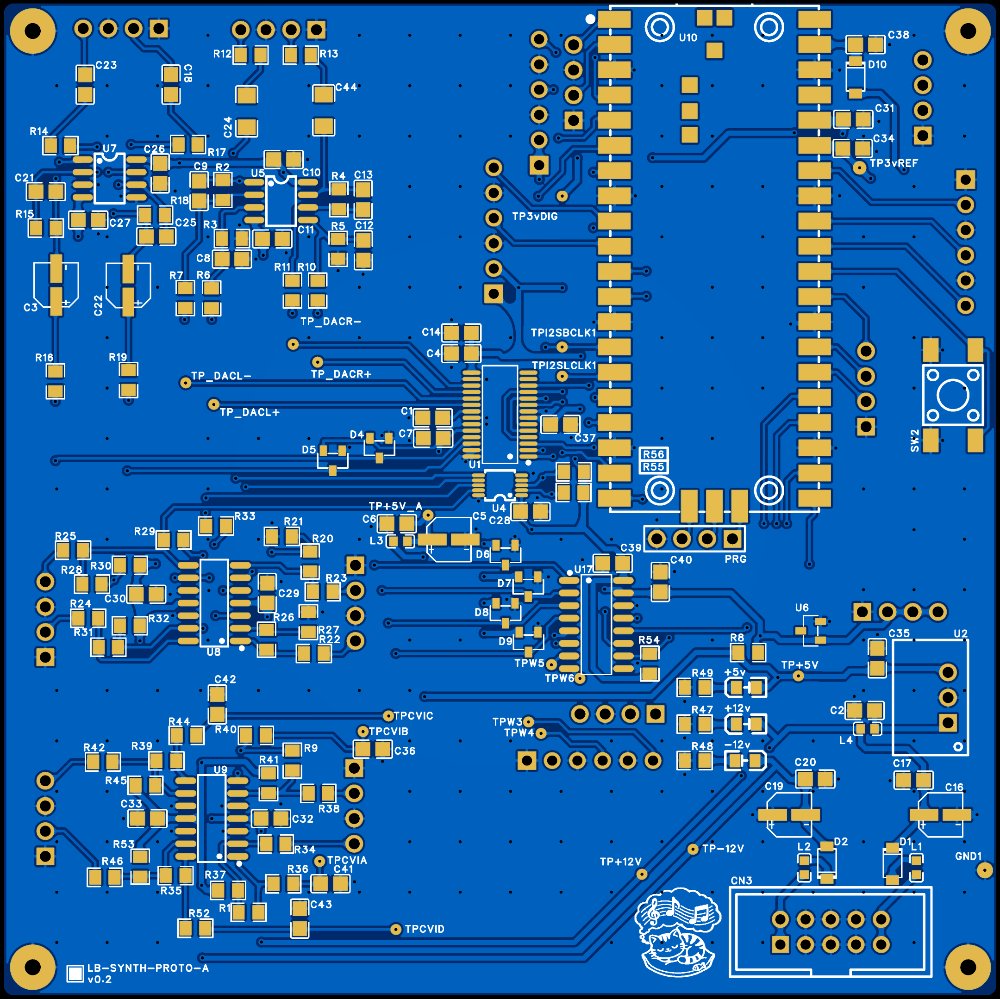
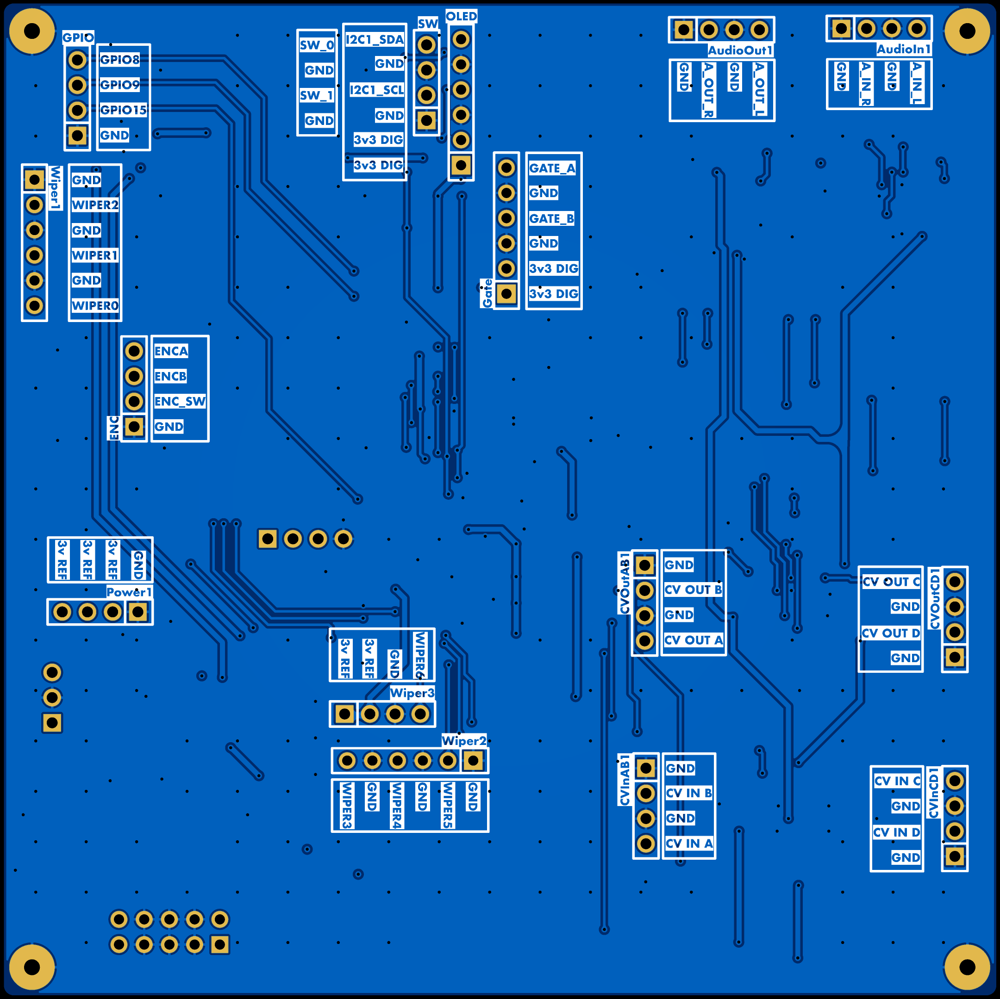
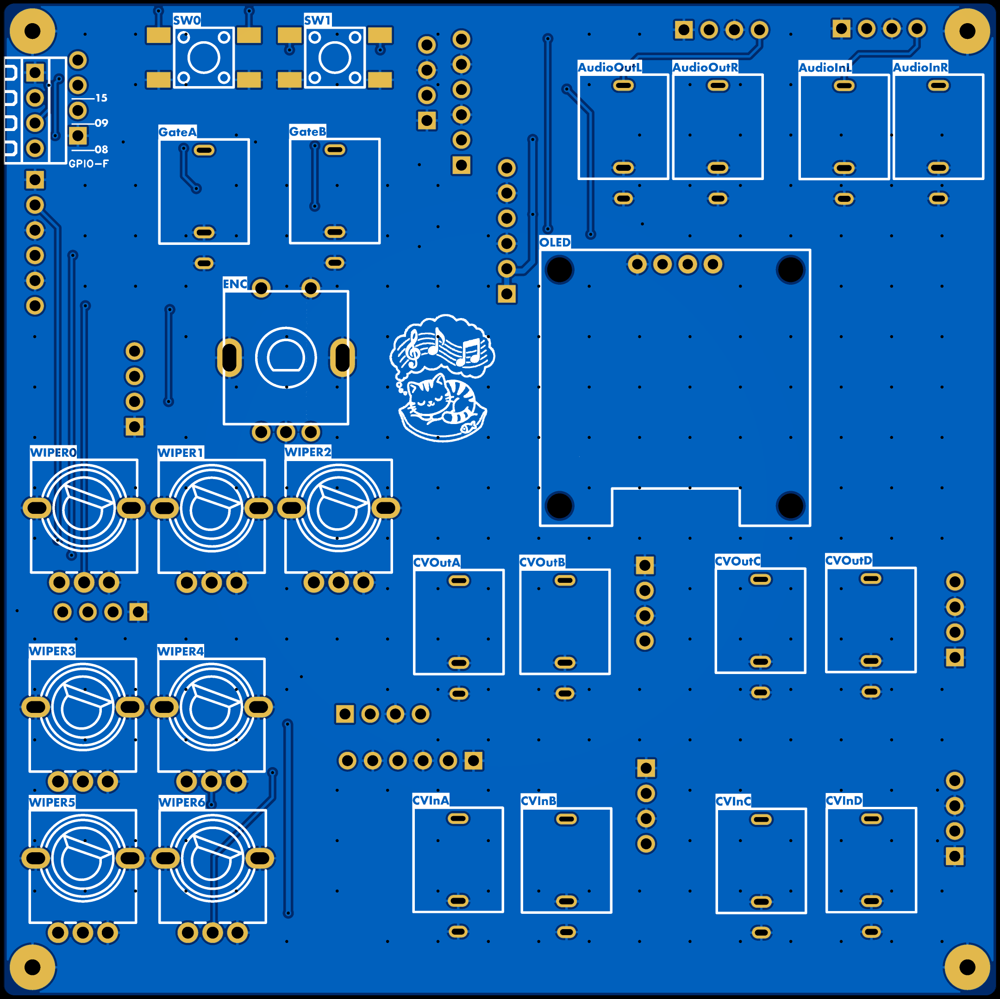
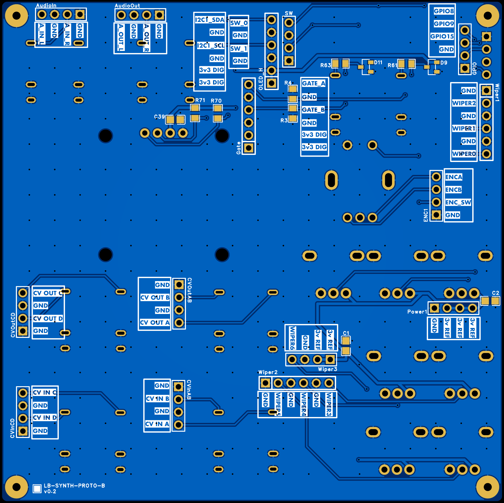
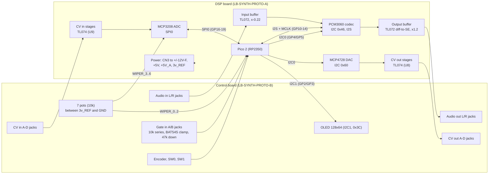

<!-- SPDX-License-Identifier: GPL-3.0-or-later -->
<!-- Copyright (C) 2026 Louis Brooks -->

# pico2-eurorack hardware

Hardware design files and documentation for the **pico2-eurorack development board**: a two-board, Raspberry Pi Pico 2 (RP2350) based Eurorack-style audio and CV platform. The firmware that runs on it lives in [`../multi-dsp/`](../multi-dsp/).

This document is written for two audiences: people who want to build or modify the boards, and AI agents or developers who need exact signal paths, pin maps and electrical limits in order to write or adapt firmware. Every number below is traced to one of these sources, tagged where it matters:

| Tag | Source |
|---|---|
| **(S)** | Schematic PDF, `schematic/schematic_v0.2.pdf` |
| **(P)** | PCB renders and PCB PDFs in `images/` and `pcb/` |
| **(C)** | Component placement lists in `cpl/` (and BOM tables inside the PCB PDFs) |
| **(D)** | Manufacturer datasheet (PCM3060, checked while writing) |
| **(F)** | Firmware source in `../multi-dsp/main.cpp` |
| **(calc)** | Calculated here from the schematic component values, **not measured on a built board** |

Section 12 lists what is still unverified and section 11 describes how the firmware (revision 3.3) maps its CV values onto this hardware. Read those before trusting a number.

## Contents

1. [At a glance](#1-at-a-glance)
2. [Files in this folder](#2-files-in-this-folder)
3. [Architecture and block diagram](#3-architecture-and-block-diagram)
4. [Mechanical: the two-board stack](#4-mechanical-the-two-board-stack)
5. [Power](#5-power)
6. [MCU pin map](#6-mcu-pin-map)
7. [Audio path](#7-audio-path)
8. [CV and gate](#8-cv-and-gate)
9. [Controls and display](#9-controls-and-display)
10. [Inter-board headers](#10-inter-board-headers)
11. [Hardware and firmware integration notes](#11-hardware-and-firmware-integration-notes)
12. [Unverified items and open questions](#12-unverified-items-and-open-questions)
13. [Bring-up checklist and test points](#13-bring-up-checklist-and-test-points)
14. [Parts and manufacturing](#14-parts-and-manufacturing)
15. [Licence and credits](#15-licence-and-credits)

---

## 1. At a glance

| Item | Value |
|---|---|
| Project name in schematic title block | `PicoDev` (`/dev/dsp`) |
| Revision | **V0.2** (both boards) |
| DSP board | **LB-SYNTH-PROTO-A v0.2**: Pico 2, codec, converters, analog front end, power **(P)** |
| Control board | **LB-SYNTH-PROTO-B v0.2**: panel jacks, pots, encoder, buttons, OLED **(P)** |
| EDA tool | EasyEDA (title block and PDF export style) **(S)** |
| Schematic dates | Created 2026-10-07 to 2026-10-09, last updated 2026-11-01 **(S)** |
| Board outline | Roughly 100 mm x 100 mm each, four corner mounting holes, estimated from the renders and CPL coordinates; confirm against the Gerber outline **(P)** |
| Copper layers | Two (top and bottom) with ground pours, as rendered **(P)** |
| MCU | Raspberry Pi Pico 2 module (RP2350), soldered as an SMD module (U10) |
| Audio codec | TI PCM3060, 24-bit stereo, I²C control, I²S data (U1) |
| CV outputs | 4 x (MCP4728 12-bit DAC + TL074 stage) (U4, U8) |
| CV inputs | 4 x (TL074 stage + MCP3208 12-bit ADC) (U9, U17) |
| Pots | 7 x 10 kΩ: 3 on the RP2350 ADC, 4 on the MCP3208 |
| Gate inputs | 2, wired to GP6 and GP7 (not used by current firmware) |
| UI | 0.96 in 128x64 OLED, rotary encoder with switch, 2 tact buttons |
| Power input | Eurorack 2x5 header (CN3), +12 V and -12 V only; +5 V is made on board |
| Analog rails | +/-12 V (through ferrite + Schottky), +5 V_A for the codec, 3.0 V reference |
| Sample rate set by firmware | 46,875 Hz (MCLK 24 MHz = 512 x fs); see [`../multi-dsp/README.md`](../multi-dsp/README.md) section 3 |
| Parts count | DSP board 161 placed items (143 SMD), control board 52 (13 SMD) **(C)** |

Headline analog figures **(calc)**, with the details in sections 7 and 8:

| Path | Result |
|---|---|
| Audio in | Gain x -0.22 (inverting), 100 kΩ input impedance, ADC full scale at about 13.6 Vpp in |
| Audio out | Differential to single-ended gain x1.2, 1 kΩ output impedance, DAC full scale (0 dB) about 9.6 Vpp out |
| CV in | Inverting, +5 V to -5 V maps to 0 V to 3.0 V at the ADC (12 bit, about 2.44 mV per count at the jack) |
| CV out A, B | 0 V to about 8.0 V (unipolar) when the MCP4728 runs from its 3.3 V supply reference |
| CV out C, D | Inverting with offset: output = +5 V - 5 x DAC voltage, so DAC code 0 gives about +5 V and a high code goes negative. Firmware 3.3 maps the modules' 0 to 4095 onto 0 to about +4.9 V on these two channels |

---

## 2. Files in this folder

```
hardware/
├── README.md                      this file
├── schematic/
│   └── schematic_v0.2.pdf         6 pages: control board (1), DSP board (5)
├── pcb/
│   ├── dsp_board_pcb.pdf          layer views and BOM table, DSP board
│   └── control_board_pcb.pdf      layer views and BOM table, control board
├── cpl/                           pick-and-place lists (JLCPCB-style columns)
│   ├── dsp_board_cpl.xlsx / .csv
│   └── control_board_cpl.xlsx / .csv
├── bom/                           BOMs grouped by part, with LCSC numbers
│   ├── dsp_board_bom.csv
│   └── control_board_bom.csv
├── images/                        PCB renders and schematic page images
│   ├── dsp_board_bom.csv
│   └── control_board_bom.csv
└── gerber/                        Gerber/Drill files
    ├── dsp_board.zip
    └── control_board.zip

```

The BOM CSVs were assembled from the BOM tables in the PCB PDFs and checked against the CPL files: every one of the 161 (DSP) and 52 (control) placed designators appears in exactly one BOM line, with none missing or extra.

### Schematic page map

| PDF page | Content | Image |
|---|---|---|
| 1 | Control board: jacks, pots, buttons, encoder, OLED, gate clamps, headers | [`images/sch_control_board.png`](images/sch_control_board.png) |
| 2 | DSP board: Pico, PCM3060, MCP4728, MCP3208, all headers | [`images/sch_dsp_1_mcu_codec_dac_adc.png`](images/sch_dsp_1_mcu_codec_dac_adc.png) |
| 3 | DSP board: audio input and output buffers | [`images/sch_dsp_2_audio_io.png`](images/sch_dsp_2_audio_io.png) |
| 4 | DSP board: CV output stages | [`images/sch_dsp_3_cv_outputs.png`](images/sch_dsp_3_cv_outputs.png) |
| 5 | DSP board: CV input stages | [`images/sch_dsp_4_cv_inputs.png`](images/sch_dsp_4_cv_inputs.png) |
| 6 | DSP board: power, reference, LEDs, CN3 | [`images/sch_dsp_5_power.png`](images/sch_dsp_5_power.png) |

(The page numbers inside the title blocks read "Page 1 of 1" for the control board and "Page 1 to 5 of 5" for the DSP board, because the two boards are separate schematics in one PDF.)

### PCB renders

| Image | What it shows |
|---|---|
| [`images/dsp_board_top.png`](images/dsp_board_top.png) | DSP board, top copper and silkscreen (Pico, codec, op-amps) |
| [`images/dsp_board_top_all_layers.png`](images/dsp_board_top_all_layers.png) | DSP board with both copper layers and the Pico pin names |
| [`images/dsp_board_bottom.png`](images/dsp_board_bottom.png) | DSP board underside: female headers that mate with the control board |
| [`images/control_board_top.png`](images/control_board_top.png) | Control board, header side (faces the DSP board), pin-name silkscreen |
| [`images/control_board_top_all_layers.png`](images/control_board_top_all_layers.png) | Control board, both copper layers |
| [`images/control_board_bottom_panel_side.png`](images/control_board_bottom_panel_side.png) | Control board panel side: jacks, pots, encoder, OLED |





---

## 3. Architecture and block diagram



Key architectural facts:

* **Two PCBs, one stack.** Everything that touches the panel (jacks, pots, buttons, encoder, display) is on the control board. Everything else (MCU, converters, analog stages, power) is on the DSP board. They join through fifteen pin-header pairs ([section 10](#10-inter-board-headers)).
* **Audio is AC-coupled in both directions** (1 µF in, 10 µF out). It does not pass DC. CV is DC-coupled.
* **Two I²C buses.** `I2C0` (GP4/GP5, 4.7 kΩ pull-ups on the DSP board) carries the codec and the CV DAC. `I2C1` (GP2/GP3, 4.7 kΩ pull-ups on the control board) carries only the OLED.
* **One SPI bus** (SPI0, GP16 to GP19) serves only the MCP3208.
* **One ground net.** The schematic uses a single `GND` for analog and digital (all PCM3060 ground pins included); there is no separate analog ground **(S)**.

---

## 4. Mechanical: the two-board stack

The boards are designed to be stacked face to face with the DSP board on top:

```
   Pico 2 and analog parts  (DSP board, top side)
   ============================================  DSP board
   female headers (DSP board bottom side)
   male headers   (control board top side)
   ============================================  Control board
   jacks, pots, encoder, OLED  (control board bottom side = front panel side)
```

* Control board parts on the **bottom** layer: all 14 jacks, 7 pots, encoder, OLED, SW0, SW1, the `GPIO-F` header. Parts on the **top** layer: pin headers, gate clamps, I²C pull-ups, decoupling **(C)**.
* DSP board parts on the **top** layer: everything except the 15 female headers, which are on the **bottom** layer **(C)**.
* **The mating headers line up.** Comparing the two CPL files, all 15 header pairs sit at identical X/Y coordinates and rotations to within 0.02 mm, which is what a direct stack needs:

| Control board header | DSP board header | X (mm) | Y (mm) |
|---|---|---|---|
| `AudioIn` | `AudioIn1` | 11.938 | -2.540 |
| `AudioOut` | `AudioOut1` | 27.813 | -2.667 |
| `SW` | `SW` | 57.531 | -8.001 |
| `OLED_H` | `OLED` | 54.05 | -9.96 |
| `GPIO` | `GPIO` | 92.710 | -9.525 |
| `Gate` | `Gate` | 49.48 | -22.93 |
| `Wiper1` | `Wiper1` | 97.028 | -24.130 |
| `ENC1` | `ENC` | 86.995 | -38.862 |
| `CVOutAB` | `CVOutAB1` | 35.560 | -60.452 |
| `CVOutCD` | `CVOutCD1` | 4.31 | -62.11 |
| `Power1` | `Power1` | 90.424 | -61.341 |
| `Wiper3` | `Wiper3` | 61.976 | -71.628 |
| `Wiper2` | `Wiper2` | 59.182 | -76.327 |
| `CVInAB` | `CVInAB1` | 35.433 | -80.899 |
| `CVInCD` | `CVInCD1` | 4.32 | -82.16 |

* Four mounting holes, one per corner, in matching positions on both boards **(P)**. Hole diameter and the standoff height needed to join 2.54 mm headers are not stated in the files; **measure before ordering standoffs**.

---

## 5. Power

### 5.1 Power tree **(S)**

```
CN3 (Eurorack 2x5)
 ├─ +12V ── L1 (ferrite) ── D1 (1N5819HW) ──┬── +12V-F ── op-amps, LED, and (via L4) the 5 V regulator
 ├─ -12V ── L2 (ferrite) ── D2 (1N5819HW) ──┴── -12V-F ── op-amps, LED, CV offset resistors
 └─ GND (pins 3 to 8)

+12V-F ── L4 (ferrite) ── U2 K7805-500R3 ── +5V ──┬── L3 (ferrite) ── +5V_A  (PCM3060 VCC, audio input clamps)
                                                   ├── D10 (1N5819HW) ── Pico VSYS (pin 39)
                                                   ├── R8 330 Ω ── U6 LM4040B30 ── 3v_REF (3.0 V)
                                                   └── +5V LED

Pico 3V3(OUT) (pin 36) ── +3V3_DIG ── PCM3060 VDD, MCP4728, MCP3208, I²C pull-ups, OLED, gate/CV clamps
```

### 5.2 Rails

| Rail | Source | Used by | Notes |
|---|---|---|---|
| `+12V`, `-12V` | CN3 | Input to the filter and diode stage | Eurorack bus |
| `+12V-F`, `-12V-F` | After L1/D1 and L2/D2 | TL072/TL074 op-amps, rail LEDs, offset resistors R30/R32 (CV out) and R37/R41/R45/R53 (CV in) | One Schottky drop below the bus (about 0.2 to 0.4 V, not measured). The offset resistors reference this rail, so output and input offsets move with it |
| `+5V` | U2 K7805-500R3 from `+12V-F` through ferrite L4, with C2 10 µF in and C35 22 µF out | Pico VSYS (through D10), 3.0 V reference bias, +5V LED, `+5V_A` | A 5 V regulator module in a 3-pin through-hole package (the "500" is the current rating in mA); datasheet not supplied |
| `+5V_A` | `+5V` through ferrite L3, C5 10 µF and C6 100 nF | PCM3060 VCC, audio-input clamp diodes D4/D5 | Analog supply for the codec. TP+5V_A |
| `+3V3_DIG` | Pico on-board regulator, pin 36 | Everything digital, converter supplies, pull-ups, clamps | Not a precision reference; it is also the reference for the MCP4728 as the firmware runs it |
| `3v_REF` | U6 LM4040B30FTA (3.0 V shunt reference) fed from `+5V` through R8 330 Ω, C34 100 nF at the Pico | MCP3208 VREF, Pico ADC_VREF (pin 35), top end of all 7 pots | Bias current about 6.1 mA less loads (the pots draw about 2.1 mA in total) **(calc)**, comfortably inside a shunt reference's operating range |

* **Reverse-polarity protection:** the box header (`CONN-TH_10P-P2.54_254V-10P-B`, a shrouded keyed type) prevents mis-plugging mechanically, and D1/D2 block a reversed supply electrically **(S, C)**.
* **No +5 V pin on CN3.** The Eurorack 10-pin power header carries only +/-12 V, so +5 V is generated on board.
* **CN3 pinout (S):** pins 1 and 2 = `-12V`, pins 3 to 8 = `GND`, pins 9 and 10 = `+12V`. Pin 1 is marked on the board; follow the standard Eurorack red-stripe convention (red stripe on the -12 V side).
* **Rail indicator LEDs:** `+12v` (R47 3.3 kΩ), `-12v` (R48 3.3 kΩ), `+5v` (R49 1 kΩ). About 3 mA each at the nominal rail voltage **(calc)**.
* **Decoupling:** 100 nF on every op-amp supply pin pair (U5/U7: C10, C11, C26, C27; U8: C29, C30; U9: C32, C33), plus bulk 10 µF electrolytics on `+12V-F` (C16) and `-12V-F` (C19) and 100 nF at C17, C20.

---

## 6. MCU pin map

The Pico 2 is soldered on the DSP board as U10. This table reproduces the schematic net names and the firmware usage side by side. Pin numbers are the Pico 2 castellated edge pins as drawn in the schematic and as printed on the board render [`images/dsp_board_top_all_layers.png`](images/dsp_board_top_all_layers.png) **(S, P)**.

| Pico pin | GPIO | Net | Connects to | Firmware (F) |
|---|---|---|---|---|
| 1 | GP0 | `SW_0` | SW0 button to GND (control board) | `PIN_BTN_SELECT` = 0, internal pull-up |
| 2 | GP1 | `SW_1` | SW1 button to GND | `PIN_BTN_EDIT` = 1, internal pull-up |
| 4 | GP2 | `I2C1_SDA` | OLED SDA, R70 4.7 kΩ pull-up | I²C1 at 400 kHz, address 0x3C |
| 5 | GP3 | `I2C1_SCL` | OLED SCL, R71 4.7 kΩ pull-up | I²C1 |
| 6 | GP4 | `I2C0_SDA` | PCM3060 MD/SDA, MCP4728 SDA, R55 4.7 kΩ pull-up | I²C0 at 400 kHz |
| 7 | GP5 | `I2C0_SCL` | PCM3060 MC/SCL, MCP4728 SCL, R56 4.7 kΩ pull-up | I²C0 |
| 9 | GP6 | `GATE_A` | Gate In A (clamped, 10 kΩ series) | Not used |
| 10 | GP7 | `GATE_B` | Gate In B | Not used |
| 11 | GP8 | `GPIO8` | `GPIO` header and `GPIO-F` panel header | Not used |
| 12 | GP9 | `GPIO9` | `GPIO` and `GPIO-F` headers | Not used |
| 14 | GP10 | `I2S_BCLK` | PCM3060 BCK1 and BCK2, test point `TPI2SBCLK1` | PIO I²S clock base (`SCK`), 3.000 MHz |
| 15 | GP11 | `I2S_LRCK` | PCM3060 LRCK1 and LRCK2, test point `TPI2SLCLK1` | PIO I²S word select (`WS`), 46.875 kHz |
| 16 | GP12 | `I2S_ADC_DATA` | PCM3060 DOUT (ADC data to MCU) | PIO RX data pin |
| 17 | GP13 | `I2S_DAC_DATA` | PCM3060 DIN (MCU to DAC data) | PIO TX data pin |
| 19 | GP14 | `I2S_MCLK` | PCM3060 SCKI1 and SCKI2 | PWM output, 24 MHz (512 x fs) |
| 20 | GP15 | `GPIO15` | `GPIO` and `GPIO-F` headers | Not used |
| 21 | GP16 | `SPI_DOUT` | MCP3208 DOUT (MISO) | SPI0 RX, `PIN_MISO` = 16 |
| 22 | GP17 | `SPI_CS` | MCP3208 CS#, **R54 10 kΩ pull-up to +3V3_DIG** | `PIN_CS` = 17 |
| 24 | GP18 | `SPI_CLK` | MCP3208 CLK | SPI0 SCK, `PIN_SCK` = 18 |
| 25 | GP19 | `SPI_DIN` | MCP3208 DIN (MOSI) | SPI0 TX, `PIN_MOSI` = 19 |
| 26 | GP20 | `ENC_SW` | Encoder push switch (control board) | `PIN_ENC_SW` = 20, internal pull-up |
| 27 | GP21 | `ENC_B` | Encoder B | `PIN_ENC_B` = 21, internal pull-up |
| 29 | GP22 | `ENC_A` | Encoder A | `PIN_ENC_A` = 22, internal pull-up |
| 30 | RUN | `RESET` | SW2 reset button to GND | n/a |
| 31 | GP26 / ADC0 | `WIPER_0` | Pot 0 wiper | RP2350 ADC input 0 (pot 1) |
| 32 | GP27 / ADC1 | `WIPER_1` | Pot 1 wiper | RP2350 ADC input 1 (pot 2) |
| 34 | GP28 / ADC2 | `WIPER_2` | Pot 2 wiper | RP2350 ADC input 2 (pot 3) |
| 35 | ADC_VREF | `3v_REF` | 3.0 V reference | n/a |
| 36 | 3V3(OUT) | `+3V3_DIG` | Digital rail | n/a |
| 39 | VSYS | from `+5V` via D10 | Pico supply | n/a |
| 3, 8, 13, 18, 23, 28, 33, 38 | GND | `GND` | | |
| 37, 40 | 3V3_EN, VBUS | (no connection) | | |
| n/a | SWCLK, GND, SWDIO | `PRG` header | 4-pin SWD programming header | n/a |

Notes:

* The SPI net names are from the MCP3208's point of view: `SPI_DIN` is the ADC's data input and therefore the MCU's MOSI (GP19), `SPI_DOUT` is the ADC's output and the MCU's MISO (GP16).
* GP12 and GP13 are the only I²S data pins; the firmware PIO program uses GP10 as `SCK` and GP11 as `WS` (`side_set` bit 0 and bit 1) with GP13 as TX data and GP12 as RX data **(F, `i2s.pio`)**.
* The Pico 2 module's own GPIO23 (SMPS mode), GPIO24 (VBUS sense), GPIO25 (LED) and GPIO29 (VSYS sense) are internal to the module and not broken out on this board. The six pads TP1 to TP6 in the Pico symbol have no connection in the schematic.
* The `RESET` button SW2 shorts `RUN` to GND. There is no separate BOOTSEL button on the DSP board; use the BOOTSEL button on the Pico 2 module itself, or the SWD `PRG` header.

---

## 7. Audio path

Components are on the DSP board, schematic page 3 ([`images/sch_dsp_2_audio_io.png`](images/sch_dsp_2_audio_io.png)).

### 7.1 Codec **(S, D)**

| Item | Value |
|---|---|
| Part | PCM3060PWR (U1), 28-pin TSSOP |
| Control | I²C, `MODE` pin tied to GND; `MS#/ADR/IFMD` tied to GND (address bit 0), so the 7-bit address is **0x46** (the firmware writes to 0x46) |
| Interface | Slave, I²S, 24-bit; the MCU is the clock master |
| Clocks | SCKI1 and SCKI2 on `I2S_MCLK`, BCK1/BCK2 on `I2S_BCLK`, LRCK1/LRCK2 on `I2S_LRCK` (ADC and DAC share one clock set) |
| Supplies | VCC = `+5V_A` (datasheet range 4.5 to 5.5 V), VDD = `+3V3_DIG` (2.7 to 3.6 V) |
| Reset | `RST#` tied to `+3V3_DIG`; no hardware reset line. The firmware resets through register 0x40 |
| Zero-detect | `ZEROL`, `ZEROR` unconnected (no-connect markers) |
| VCOM | 10 µF (C1) to ground |
| System clock | 2.048 to 36.864 MHz allowed; 24 MHz is used |
| Input full scale | 0.6 x VCC peak-to-peak single-ended: **3.0 Vpp at 5 V**, input impedance 10 kΩ typical (datasheet) |
| Output full scale | Differential: **1.6 x VCC Vpp = 8 Vpp at 5 V**; single-ended 0.8 x VCC Vpp (datasheet) |
| DAC output mode used | Differential `VOUTL+`, `VOUTL-`, `VOUTR+`, `VOUTR-` go to the output buffer; test points `TP_DACL+/-`, `TP_DACR+/-` |

Register values the firmware writes are documented in [`../multi-dsp/README.md`](../multi-dsp/README.md) section 3.2 (including DAC attenuation 0 dB, de-emphasis off, differential output mode).

### 7.2 Input buffer **(S)**

For each channel (U7.1 left, U7.2 right):

```
jack ── C23 1 µF ── R14 100 kΩ ──┬── U7 (-) ── R15 22 kΩ ‖ C21 220 pF ── U7 out
                                 │   U7 (+) ── GND
U7 out ── C3 10 µF ── R16 1 kΩ ──┬── PCM3060 VINL
                                 ├── D4 BAT54S to GND
                                 └── D4 BAT54S to +5V_A
```

(Right channel: C18, R17, R18, C25, U7.2, C22, R19, D5.)

| Quantity | Value **(calc)** |
|---|---|
| Voltage gain | -22 kΩ / 100 kΩ = **-0.22** (inverting, -13.2 dB) |
| Input impedance | 100 kΩ |
| Input high-pass | 1 / (2π x 100 kΩ x 1 µF) = **1.6 Hz** |
| Low-pass | 22 kΩ with 220 pF = **32.9 kHz** |
| ADC full scale at the jack | 1.5 V peak / 0.22 = **6.8 V peak (13.6 Vpp)** |
| A 10 Vpp (+/-5 V) signal reads | 0.22 x 5 V / 1.5 V = 0.73 of full scale, **-2.7 dBFS** |
| Protection | BAT54S pairs to GND and `+5V_A` limit the ADC pin to roughly -0.3 V to 5.3 V; 1 kΩ series |

The input stage inverts the signal and the output stage does not (assuming the codec's `+` output is in phase with its data), so a straight pass-through from Audio In to Audio Out comes out polarity-inverted. That is inaudible on its own, but it matters if the output is later mixed with the original signal in an external mixer.

### 7.3 Output buffer **(S)**

For each channel (U5.1 left, U5.2 right): a differential amplifier converts the codec's balanced output to a single-ended signal.

```
DAC_OUT_L- ── R7 10 kΩ ──┬── U5 (-) ── R2 12 kΩ ‖ C9 220 pF ── U5 out
DAC_OUT_L+ ── R6 10 kΩ ──┬── U5 (+) ── R3 12 kΩ ‖ C8 220 pF ── GND
U5 out ── C24 10 µF ── R12 1 kΩ ── jack
```

(Right channel: R11, R10, R4, R5, C12, C13, U5.2, C44, R13.)

| Quantity | Value **(calc)** |
|---|---|
| Voltage gain on the differential signal | 12 kΩ / 10 kΩ = **x1.2** |
| DAC full scale (0 dB register setting) | 8 Vpp differential x 1.2 = **9.6 Vpp = +/-4.8 V peak**, about 9.5 Vpp into 100 kΩ |
| Output impedance | **1 kΩ** (R12/R13) |
| Output coupling high-pass | 10 µF into 100 kΩ = 0.16 Hz; into 10 kΩ = 1.4 Hz |
| Low-pass | 12 kΩ with 220 pF = 60 kHz (matched on both inputs so the common-mode balance holds) |
| Headroom | TL072 on +/-12 V rails swings further than +/-4.8 V, so the amplifier does not clip before the DAC does |

So the output is in standard Eurorack territory (about 10 Vpp) at full scale **(calc, requires VCC = 5.0 V)**. The 0 dB DAC setting (firmware default since the -6 dB attenuation was removed) therefore uses the full range, and loud material can reach +/-4.8 V.

---

## 8. CV and gate

### 8.1 CV outputs **(S, calc)**

Four channels: MCP4728 (U4) output, then a TL074 (U8) stage, then 1 kΩ, then the jack. Schematic page 4 ([`images/sch_dsp_3_cv_outputs.png`](images/sch_dsp_3_cv_outputs.png)).

**DAC.** MCP4728T-E/UN, I²C address 0x60, `LDAC#` tied to GND (outputs update immediately), `VDD` = `+3V3_DIG`. The firmware's write command (`0x40 | ch << 1`) leaves the voltage-reference bit at its VDD setting and the gain at x1, so the reference is the 3.3 V digital rail **(F)**. The DAC output is 0 to about 3.3 V.

| Channel | DAC pin | Op-amp | Topology | Components |
|---|---|---|---|---|
| CV Out A | VOUTA (pin 6) | U8.1 | Non-inverting, gain 1 + 14.3k/10k = **x2.43** | R27 10 kΩ to GND, R26 14.3 kΩ feedback, R22 1 kΩ out |
| CV Out B | VOUTB (pin 7) | U8.2 | Non-inverting, **x2.43** | R21 10 kΩ, R20 14.3 kΩ, R23 1 kΩ out |
| CV Out C | VOUTC (pin 8) | U8.3 | **Inverting summing**, gain -5 with +5 V offset | R33 20 kΩ in, R28 100 kΩ feedback, R30 240 kΩ to `-12V-F`, R25 1 kΩ out |
| CV Out D | VOUTD (pin 9) | U8.4 | **Inverting summing**, same as C | R29 20 kΩ in, R31 100 kΩ feedback, R32 240 kΩ to `-12V-F`, R24 1 kΩ out |

The control board labels jack C "Bipolar CV Out C" (silkscreen and BOM comment), and the circuit for D is identical to C.

Transfer functions, with `Vdac = 3.3 V x code / 4096` and the nominal values above:

* **A and B:** `Vout = 2.43 x Vdac`, range **0 V to about 8.0 V**, step about 1.96 mV.
* **C and D:** `Vout = 5.0 V - 5 x Vdac` (the 5 V is `|-12V-F| x 100k / 240k`, so about 4.9 V in practice), range from **+5 V at code 0** down through 0 V at Vdac = 1.0 V, to -5 V at Vdac = 2.0 V, step about 4.03 mV. Codes beyond about 3700 ask for more than about -10 V and run into the TL074's output swing on the +/-12 V rails.

| DAC code | Vdac | A and B out | C and D out |
|---|---|---|---|
| 0 | 0.000 V | 0.00 V | +5.00 V |
| 1241 | 1.000 V | 2.43 V | 0.00 V |
| 2048 | 1.650 V | 4.01 V | -3.25 V |
| 2482 | 2.000 V | 4.86 V | -5.00 V |
| 3724 | 3.000 V | 7.29 V | -10.00 V (near amplifier limit) |
| 4095 | 3.299 V | 8.02 V | -11.50 V (beyond amplifier limit, will clip) |

To command a voltage `V` on C or D: `Vdac = (5 - V) / 5`, then `code = Vdac x 4096 / 3.3`. For +/-5 V use codes 0 to about 2482 (zero volts at about 1241). Firmware revision 3.3 applies this mapping itself (`dac_hw_code()` and `cvout_cd_code_from_volts()` in `main.cpp`); see [section 11](#11-hardware-and-firmware-integration-notes).

The output accuracy follows the Pico's 3.3 V regulator, which is not a precision reference **(calc, unverified)**. Output stages have 1 kΩ output impedance.

### 8.2 CV inputs **(S, calc)**

Four channels: jack, then a TL074 (U9) stage, then 1 kΩ and 100 nF, then the MCP3208. Schematic page 5 ([`images/sch_dsp_4_cv_inputs.png`](images/sch_dsp_4_cv_inputs.png)).

```
jack ── R34 100 kΩ ──┬── U9.1 (-) ── R1 30 kΩ ── U9.1 out ── R36 1 kΩ ──┬── CV_IN_A (to MCP3208 CH0)
                     │   U9.1 (+) ── GND                                ├── C41 100 nF to GND
-12V-F ── R37 240 kΩ ┘                                                  └── D6 BAT54S to GND and +3V3_DIG
```

| Channel | Op-amp | Input R | Feedback R | Offset R to `-12V-F` | Filter | Clamp | ADC channel |
|---|---|---|---|---|---|---|---|
| CV In A | U9.1 | R34 100 kΩ | R1 30 kΩ | R37 240 kΩ | R36 1 kΩ, C41 100 nF | D6 | CH0 |
| CV In B | U9.2 | R38 100 kΩ | R9 30 kΩ | R41 240 kΩ | R40 1 kΩ, C36 100 nF | D7 | CH1 |
| CV In C | U9.3 | R42 100 kΩ | R39 30 kΩ | R45 240 kΩ | R44 1 kΩ, C42 100 nF | D8 | CH2 |
| CV In D | U9.4 | R46 100 kΩ | R35 30 kΩ | R53 240 kΩ | R52 1 kΩ, C43 100 nF | D9 | CH3 |

Transfer function: `Vadc = 1.5 V - 0.3 x Vin`. (Designators D6 to D9 here are on the DSP board; the control board has its own D9 and D11 for the gate inputs.)

| Vin at the jack | Vadc at the MCP3208 | 12-bit count |
|---|---|---|
| +5.0 V | 0.00 V | 0 |
| +2.5 V | 0.75 V | 1024 |
| 0 V | 1.50 V | 2048 |
| -2.5 V | 2.25 V | 3072 |
| -5.0 V | 3.00 V | 4095 |

* Input range **+/-5 V**, input impedance 100 kΩ, DC-coupled, **inverting**: counts = 2048 - 409.6 x Vin, about 2.44 mV per count at the jack.
* The 1.5 V mid-point comes from the offset resistor and `-12V-F`. If `-12V-F` sits near -11.7 V the zero-volt reading moves to about 1990 counts (about 50 counts below 2048), so calibrate or trim in firmware.
* ADC reference is the 3.0 V `3v_REF`; the MCP3208 `VDD` is `+3V3_DIG`. Anything beyond the +/-5 V range is clipped at the ADC and then clamped by BAT54S diodes to `+3V3_DIG` and GND through 1 kΩ.
* 1 kΩ with 100 nF gives a low-pass at about 1.6 kHz, which is fine for CV but means the inputs are not for audio-rate use. For audio in, use the audio jacks.

### 8.3 Gate inputs **(S, calc)**

On the control board, jacks `GateA` and `GateB`:

```
jack ── R61 10 kΩ ──┬── GATE_A (to Pico GP6)
                    ├── R4 47 kΩ to GND
                    └── D9 BAT54S to GND and +3V3_DIG
```

(Gate B: R63, R3, D11, GP7.) A resistive divider of 47 kΩ / (10 kΩ + 47 kΩ) scales the input by 0.82, and the clamp diodes limit the Pico pin to about -0.3 V to 3.6 V. A 5 V gate gives about 4.1 V before clamping. Check the RP2350 input-high threshold if you need to reliably detect gates below about 3 V. The firmware does not currently read GP6 or GP7.

---

## 9. Controls and display

All on the control board, schematic page 1 ([`images/sch_control_board.png`](images/sch_control_board.png)).

### 9.1 Potentiometers

* Seven 10 kΩ panel pots (`RK09L114001T`), each across `3v_REF` and `GND` with the wiper to a `WIPER_n` net, so readings are ratiometric against the ADC reference.
* `WIPER_0`, `WIPER_1`, `WIPER_2` go to the RP2350 ADC (GP26, GP27, GP28 on the Pico) and are firmware pots 1 to 3.
* `WIPER_3` to `WIPER_6` go to MCP3208 channels CH4 to CH7 and are firmware pots 4 to 7.
* The firmware inverts all seven readings (`1.0 - x`) **(F)**, so that clockwise increases; see [section 11](#11-hardware-and-firmware-integration-notes), item 8.
* `3v_REF` has 100 nF decoupling on the control board (C1, C2).

| Pot | Net | Converter | Channel | Test point |
|---|---|---|---|---|
| WIPER0 | `WIPER_0` | RP2350 ADC | ADC0 (GP26) | n/a |
| WIPER1 | `WIPER_1` | RP2350 ADC | ADC1 (GP27) | n/a |
| WIPER2 | `WIPER_2` | RP2350 ADC | ADC2 (GP28) | n/a |
| WIPER3 | `WIPER_3` | MCP3208 | CH4 | `TPW3` |
| WIPER4 | `WIPER_4` | MCP3208 | CH5 | `TPW4` |
| WIPER5 | `WIPER_5` | MCP3208 | CH6 | `TPW5` |
| WIPER6 | `WIPER_6` | MCP3208 | CH7 | `TPW6` |

### 9.2 Encoder and buttons

* **Encoder:** Bourns `PEC11R-4215F-S0024` with push switch. A, B and SW each go to a Pico GPIO (GP22, GP21, GP20) with the common to GND. **No external pull-ups or debounce capacitors**; the firmware enables the internal pull-ups and decodes the quadrature in software **(F)**.
* **Buttons:** SW0 and SW1 (kinghelm `KH-6X6X5H-STM`, SMD tact switches on the panel side) connect `SW_0` / `SW_1` (GP0, GP1) to GND, again with internal pull-ups.

### 9.3 Display

* OLED module `HS96L03W2C03` (0.96 in, 128x64, 4-pin through-hole: GND, VCC, SCL, SDA), powered from `+3V3_DIG` with C39 100 nF. I²C1 (GP2 SDA, GP3 SCL) with R70/R71 4.7 kΩ pull-ups on the control board. Firmware address 0x3C **(F)**.

### 9.4 Expansion headers

* `GPIO` (4-pin header on the control board top, mated to the DSP board `GPIO` header): `GPIO8`, `GPIO9`, `GPIO15`, `GND`.
* `GPIO-F` (4-pin header on the panel side of the control board, `TY308-2.54-04P-14-00AH`): the same four nets, accessible in front of the board. Panel silkscreen shows "15", "09", "08", "GPIO-F" next to it.
* None of these has any protection or buffering; they connect directly to Pico GPIO pins (3.3 V logic).

---

## 10. Inter-board headers

All headers are 2.54 mm pitch. **Pin 1 is the square pad.** The control board carries the male pins, the DSP board the female sockets. Pinouts are taken from the schematic and cross-checked against the silkscreen labels in the renders **(S, P)**.

### 10.1 Four-pin headers

| Header (control / DSP) | Pin 1 | Pin 2 | Pin 3 | Pin 4 |
|---|---|---|---|---|
| `AudioIn` / `AudioIn1` | GND | `A_IN_R` | GND | `A_IN_L` |
| `AudioOut` / `AudioOut1` | GND | `A_OUT_R` | GND | `A_OUT_L` |
| `CVInAB` / `CVInAB1` | GND | `CV_IN_J_B` | GND | `CV_IN_J_A` |
| `CVInCD` / `CVInCD1` | GND | `CV_IN_J_D` | GND | `CV_IN_J_C` |
| `CVOutAB` / `CVOutAB1` | GND | `CV_OUT_J_B` | GND | `CV_OUT_J_A` |
| `CVOutCD` / `CVOutCD1` | GND | `CV_OUT_J_D` | GND | `CV_OUT_J_C` |
| `SW` / `SW` | GND | `SW_1` | GND | `SW_0` |
| `ENC1` / `ENC` | GND | `ENC_SW` | `ENC_B` | `ENC_A` |
| `GPIO` / `GPIO` | GND | `GPIO15` | `GPIO9` | `GPIO8` |
| `Wiper3` / `Wiper3` | `3v_REF` | `3v_REF` | GND | `WIPER_6` |
| `Power1` / `Power1` | GND | `3v_REF` | `3v_REF` | `3v_REF` |

`Power1` distributes the 3.0 V pot reference and ground to the control board. The `_J_` nets are the jack-side signals; on the DSP board they pass through the buffers before reaching the converters ([sections 7 and 8](#7-audio-path)).

### 10.2 Six-pin headers

| Header (control / DSP) | Pin 1 | Pin 2 | Pin 3 | Pin 4 | Pin 5 | Pin 6 |
|---|---|---|---|---|---|---|
| `Gate` / `Gate` | `+3V3_DIG` | `+3V3_DIG` | GND | `GATE_B` | GND | `GATE_A` |
| `OLED_H` / `OLED` | `+3V3_DIG` | `+3V3_DIG` | GND | `I2C1_SCL` | GND | `I2C1_SDA` |
| `Wiper1` / `Wiper1` | GND | `WIPER_2` | GND | `WIPER_1` | GND | `WIPER_0` |
| `Wiper2` / `Wiper2` | GND | `WIPER_5` | GND | `WIPER_4` | GND | `WIPER_3` |

The `+3V3_DIG` pins on the `Gate` header supply the gate-clamp diodes; those on `OLED_H` supply the display and the I²C pull-ups.

### 10.3 Power and programming

* `CN3` (DSP board, 2x5 box header): pins 1, 2 `-12V`; pins 3 to 8 `GND`; pins 9, 10 `+12V`.
* `PRG` (DSP board, 4-pin, top side): SWCLK, GND, SWDIO, GND, in the order drawn in the schematic (pin 1 to pin 4). Confirm against the board silkscreen before connecting a probe.

### 10.4 Jacks

All 14 panel jacks are 3.5 mm mono jacks (`WQP-WQP518MA`) with three terminals: the sleeve (pin 1) and the switch contact (pin 2) are both wired to GND, and the signal is on the tip (pin 3). The 14 jacks are: Audio In L/R, Audio Out L/R, CV In A to D, CV Out A to D, Gate In A/B **(S)**.

If the jack's switch contact behaves like the common Thonkiconn-style jack (closed to the tip while nothing is plugged in; not confirmed from a datasheet), an unpatched jack is shorted to ground: unpatched inputs read 0 V or silence, and unpatched outputs are shorted to ground through their 1 kΩ series resistor, which the output stages tolerate. Verify the switch behaviour on the first assembled board.

---

## 11. Hardware and firmware integration notes

How `../multi-dsp/main.cpp` (revision 3.3) relates to the analog hardware. Revision 3.2 and earlier assumed unity-gain, non-inverting CV stages, which does not match the schematic; revision 3.3 corrects that and the host test `test_cvmap` checks the code against a model of these stages.

1. **CV Out C and D are inverted and offset; the firmware now compensates.** The modules write one logical convention to all four channels (`g_dac_out[]`, 0 to 4095). Channels A and B pass straight through (0 to about 8 V). For C and D, `dac_hw_code()` maps the logical range onto 0 to about +4.9 V, so a gate idles near 0 V and goes to about +4.9 V instead of the +5 V / negative-limit behaviour the raw code would give. For other voltages use `cvout_cd_code_from_volts(volts)` (about -5 V to +4.9 V, bipolar; not used by the current modules). Because C and D only use the lowest 0.98 V of the DAC range, they have about 1,216 codes (10.2 bits).
2. **CV inputs invert polarity; the firmware now flips it.** `cv_from_counts()` computes `CV_IN_MID_COUNTS - counts` with a +/-30-count dead zone and clamps to -1...+1, so +5 V at the jack reads +1 and -5 V reads -1.
3. **Calibration constants** in `main.cpp`: `CV_IN_MID_COUNTS` (2048 nominal; about 2005 for a -11.75 V rail), `CVOUT_CD_OFFSET_V` (4.9 V nominal), `DAC_VDD_V` (3.3 V). With the jack switches grounding unpatched jacks (section 10.4), read the raw counts of an unpatched CV input to set the first; command logical 0 on C or D and trim the second until the jack reads 0 V.
4. **MCP4728 reference.** The DAC runs from the 3.3 V digital rail, which is neither precise nor quiet. The MCP4728 has an internal 2.048 V reference with a x2 gain option (4.096 V full scale); using it would improve CV accuracy and give 0 to about 9.95 V on A and B, at the cost of changing the C and D maths above. A possible future firmware change, not made or tested.
5. **Audio levels.** The DAC attenuation is 0 dB, so full scale is about +/-4.8 V and the input saturates at about +/-6.8 V (section 7). Modules that output near full scale appear at full eurorack level.
6. **Gate inputs and GPIO breakout are unused.** GP6, GP7, GP8, GP9 and GP15 are not read or driven by the firmware.
7. **Sample rate.** The codec is clocked from a 24 MHz MCLK on GP14 and a 3.000 MHz BCLK; the firmware's `SAMPLE_RATE` is 46,875 Hz, verified by a host test against `i2s.pio` **(F)**. Both fit the PCM3060's allowed 2.048 to 36.864 MHz system clock range.
8. **Pot polarity.** The firmware applies `1.0 - x` to all seven pot readings so that clockwise increases. If a future revision swaps the pot end connections, remove that inversion.
9. **Mono source on the stereo input.** The firmware currently reads only the left input and ignores the right, so a mono source must be patched into Audio In L. If a future firmware also processes the right channel, an unpatched right jack must not add noise. In v0.2 each jack’s switch contact is wired to GND (§10.4), which should hold an unpatched jack at 0 V; confirm this on the first board. A future revision may normal the right input to the left through the right jack’s switch contact, so a mono source patched into L feeds both channels instead of leaving R unconnected.

---

## 12. Bring-up checklist and test points

Suggested order for a first power-on, with the expected values **(calc)**:

1. **Visual:** check the 15 header pairs for solder bridges; check D1, D2, D10 and the electrolytics' polarity (C3, C5, C16, C19, C22).
2. **Without the Pico and without the control board**, apply +/-12 V to CN3. Measure against `GND1`:
   * `TP+12V` about +11.7 to +12 V, `TP-12V` about -11.7 to -12 V (one Schottky drop below the bus).
   * `TP+5V` about 5.0 V and `TP+5V_A` about 5.0 V. The three rail LEDs are lit.
   * `TP3vREF` about 3.0 V.
3. **Fit the Pico and the control board.** `TP3vDIG` about 3.3 V.
4. **Flash the firmware.** Check with a scope or logic analyser:
   * `TPI2SBCLK1`: **3.000 MHz**.
   * `TPI2SLCLK1`: **46.875 kHz**.
   * Pico pin 19 (`I2S_MCLK`): **24 MHz**.
5. **I²C scan:** `I2C0` should show **0x46** (PCM3060) and **0x60** (MCP4728); `I2C1` should show **0x3C** (OLED).
6. **Audio loopback:** with a pass-through module, a signal into Audio In should come out of Audio Out (polarity-inverted overall, see section 7.2). Check that a +/-5 V input stays well below clipping.
7. **CV outputs:** with firmware 3.3, a logical 0 and a logical full-scale value on each channel should read about 0 V and 8.0 V on A and B, and about 0 V and +4.9 V on C and D (trim `CVOUT_CD_OFFSET_V` if C/D are off at 0). The raw DAC voltages are in the table in section 8.1.
8. **CV inputs:** apply 0 V and +/-5 V and compare the raw counts with section 8.2; the firmware value should read about 0 and +1 / -1 (positive volts give positive values). Set `CV_IN_MID_COUNTS` from an unpatched input.
9. **Pots:** turn each pot full range and watch `TPW3` to `TPW6` (0 to 3.0 V).

### Test points (DSP board)

| Test point | Net | Use |
|---|---|---|
| `GND1` | GND | Ground reference |
| `TP+12V` / `TP-12V` | `+12V-F` / `-12V-F` | Filtered bipolar supplies |
| `TP+5V` | `+5V` | Regulator output |
| `TP+5V_A` | `+5V_A` | Codec analog supply |
| `TP3vDIG` | `+3V3_DIG` | Digital rail |
| `TP3vREF` | `3v_REF` | 3.0 V reference |
| `TPCVIA` to `TPCVID` | `CV_IN_A` to `CV_IN_D` | Conditioned CV inputs at the ADC side (0 to 3.0 V) |
| `TPW3` to `TPW6` | `WIPER_3` to `WIPER_6` | Pot wipers on MCP3208 channels CH4 to CH7 |
| `TPI2SBCLK1` | `I2S_BCLK` | Bit clock (3.000 MHz) |
| `TPI2SLCLK1` | `I2S_LRCK` | Word clock (46.875 kHz) |
| `TP_DACL+`, `TP_DACL-` | `DAC_OUT_L+/-` | Left DAC differential output |
| `TP_DACR+`, `TP_DACR-` | `DAC_OUT_R+/-` | Right DAC differential output |

---

## 14. Parts and manufacturing

### 14.1 Key parts

| Ref | Part | Function | LCSC |
|---|---|---|---|
| U10 | Raspberry Pi Pico 2 | RP2350 module | C41407547 |
| U1 | TI PCM3060PWR | 24-bit stereo codec | C2651841 |
| U4 | Microchip MCP4728T-E/UN | 4 x 12-bit DAC (CV out) | C478093 |
| U17 | Microchip MCP3208T-CI/SL | 8-ch 12-bit ADC (CV in, 4 pots) | C626764 |
| U5, U7 | TI TL072IDR | Audio output and input buffers | C6962 |
| U8, U9 | TI TL074IDR | CV output and input stages | C6964 |
| U2 | YLPTEC K7805-500R3 | +5 V regulator module | C2992390 |
| U6 | Diodes Inc. LM4040B30FTA | 3.0 V shunt reference | C460604 |
| D1, D2, D10 | 1N5819HW-7-F | Schottky diodes | C82544 |
| D4 to D9 (DSP), D9, D11 (control) | BAT54S | Clamp diodes | C7420333 |
| L1 to L4 | muRata BLM18KG601SN1D | Ferrite beads (600 Ω at 100 MHz) | C85833 |
| CN3 | JXTCONN IDC2.54-2*5PZ | Eurorack power header | C53207560 |
| ENC | Bourns PEC11R-4215F-S0024 | Rotary encoder | C143790 |
| OLED | HS96L03W2C03 | 0.96 in 128x64 OLED | C5248080 |
| 7 x WIPER | Alps Alpine RK09L114001T | 10 kΩ pots | C470463 |
| 14 x jack | WQP-WQP518MA | 3.5 mm mono jacks | C53058333 |

Full grouped BOMs with designators, footprints, manufacturers and LCSC numbers: [`bom/dsp_board_bom.csv`](bom/dsp_board_bom.csv) (40 lines) and [`bom/control_board_bom.csv`](bom/control_board_bom.csv) (13 lines). Both match the CPL files designator for designator.

Counts from the CPL files **(C)**:

| Board | Placed items | Top | Bottom | SMD | Through-hole |
|---|---|---|---|---|---|
| DSP board | 161 (including 21 test pads) | 146 | 15 | 143 | 18 |
| Control board | 52 | 26 | 26 | 13 | 39 |

### 14.2 Assembly notes

* The CPL columns (`Designator, Device, Footprint, Mid X, Mid Y, Ref X, Ref Y, Pad X, Pad Y, Pins, Layer, Rotation, SMD, Comment, Name`) are the EasyEDA / JLCPCB pick-and-place export; coordinates are in millimetres and the Y values are negative.
* On the DSP board all 143 SMD parts are on the top side. The through-hole parts are the 15 female headers (bottom side) plus CN3, PRG and U2 (top side). On the control board the SMD tact switches SW0 and SW1 are on the bottom (panel) side while the other 11 SMD parts are on top.
* The 21 test points are bare pads with no component (no manufacturer part number).
* Most parts carry LCSC numbers, so the BOM can be ordered and assembled from the JLCPCB parts library; the through-hole jacks, pots, encoder, OLED and headers are normally hand-soldered.

---

## 15. Licence and credits

Copyright (C) 2026 Louis Brooks.

The hardware files in this folder are released under the same terms as the rest of the repository: the **GNU General Public License, version 3 or (at your option) any later version** (`GPL-3.0-or-later`); see [`../LICENSE`](../LICENSE). The GPL was written for software; if you want a licence designed for hardware designs, the CERN Open Hardware Licence family is the usual alternative, and the change would be made here and in the repository README.

Schematic and PCB drawn by Louis Brooks in EasyEDA. The PCM3060 figures quoted above were checked against the TI PCM3060 datasheet.
